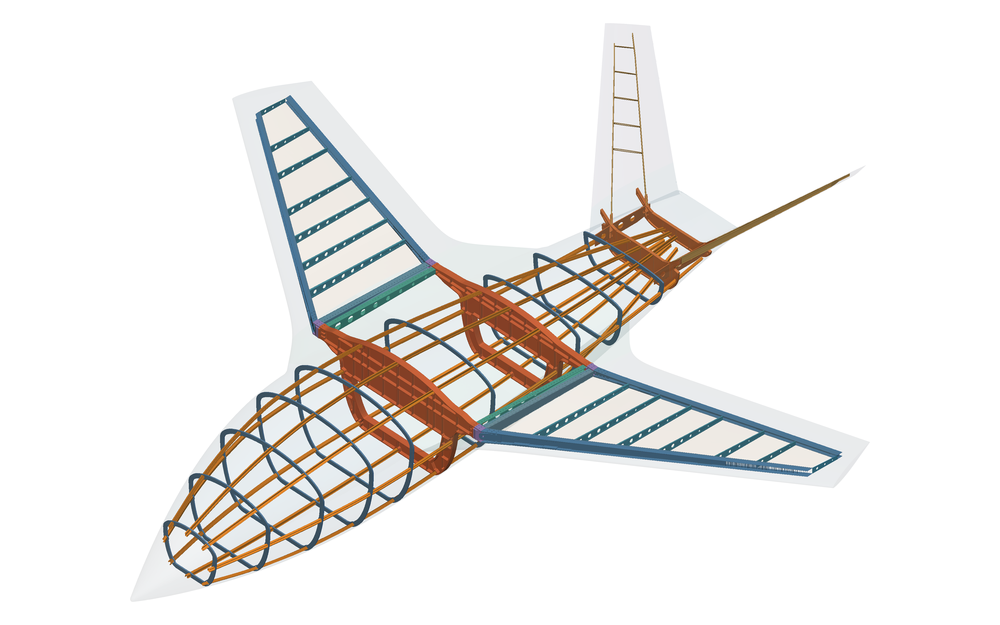

# Civil research aircraft: Revision O and 77 skin panels

**Built with Astra.**

Start with the complete Revision O aircraft in installed-skin or exploded-skin views. Both notebooks include the current structural definitions and the retained 77-panel Revision N exterior. Version 0.2.0 adds this compact current download while preserving the earlier Revision G files and reports.

## Start here

1. Download and extract **civil-research-aircraft-rev-o-skins.zip**. Keep its folders together.
2. Read [the current overview](reports/revision-o-overview.html).
3. Run `Open-current.ps1` in PowerShell, or open `rev-o-installed-skins.ntop` from a working copy of the extracted folder.
4. Use `rev-o-exploded-skins.ntop` for the exploded arrangement. Use `rev-n-skin-layout.ntop` for the separate 77-panel layout.
5. Keep `references/` beside the notebooks. If nTop asks for an input, select its matching local file under `references/` or `references/panels/`.

The native source used **nTop 6.1.0-rc build 42926**. The same build passed new extended readback of the relocated 77-panel layout. Full installed/exploded publication copies preserve all non-index native payloads, but were not rerun in nTop during this update. Public-release compatibility has not been established.

## What changed after G

- Revision N widened wing bays, reduced ordinary wing ribs to 16 across both sides, and reduced the exterior layout to 77 panels.
- Revision O aligned ten tail ribs to the local tail span and added lands and support ribs around the four spar-root forks.
- The installed and exploded models preserve the complete Revision O structure. Their panel layout comes from Revision N.
- The current download bundles 77 panel mesh inputs and two airfoil references. The panel schedule identifies every panel and its current limitations.

## Current files

| File | Purpose |
|---|---|
| [rev-o-installed-skins.ntop](rev-o-installed-skins.ntop) | Complete current structure with installed exterior panels |
| [rev-o-exploded-skins.ntop](rev-o-exploded-skins.ntop) | Complete current structure with rigid display translations of the panels |
| [rev-n-skin-layout.ntop](rev-n-skin-layout.ntop) | Separate current 77-panel layout |
| [Panel schedule](references/panel-schedule-rev-n.csv) | Panel identities, extents, region and status |
| [Publication evidence](evidence/revision-o-publication.json) | Exact source/published hashes, relocated imports and native pilot receipt |
| [Agent guide](AGENTS.md) | Current entry points, dependencies and editing limits |

The compact download does not duplicate every source-only intermediate or separate presentation. Both complete skin notebooks embed the structural definitions. Prior native revisions remain in this repository.

## Inputs, outputs and limits

| Item | Meaning |
|---|---|
| Exterior panel meshes | 77 supplied STL surfaces; no physical sheet gauge or structural credit |
| Airfoil references | Two supplied DAT files and matching CSV tables |
| Embedded structural parts | Editable saved definitions in the aircraft coordinate frame |
| Installed / exploded state | Display organization; exploded translation is not a removal sequence or tool-clearance proof |
| Revision O checks | 2,164 recorded native feature probes; finite geometric checks, not strength, buckling or fatigue qualification |

Parts use aircraft world coordinates. Do not apply another placement. Saving a standalone part does not update its embedded assembly definition. Interface changes require coordinated edits, explicit refresh and new verification.

Revision L's detailed removable-skin samples are historical examples. They do not detail the attachment of every current panel. Skin/stringer stability, tail loads, pin bearing, fatigue, production segmentation, tolerances and hardware qualification remain open. This is not a manufacturing or flight release.

## Earlier work

[The report catalogue](reports/index.html) and the original Revision G notebook remain available. The G package contains the earlier D/E/F/G structure and design studies. Its failed structural screens remain relevant historical evidence, not acceptance of the current aircraft.

Source-workspace notes for [Revision N](notes/revision-n-source-guide.md) and [Revision O](notes/revision-o-tail.md) explain the later changes and reproduction order. Their source-relative paths refer to the original workspace.

## License and attribution

MIT, as in the existing package. Preserve the included LICENSE and earlier third-party credits. Original aircraft work: Built with Astra. This update organizes and checks the existing work; it does not claim a new aircraft design or structural solve.
