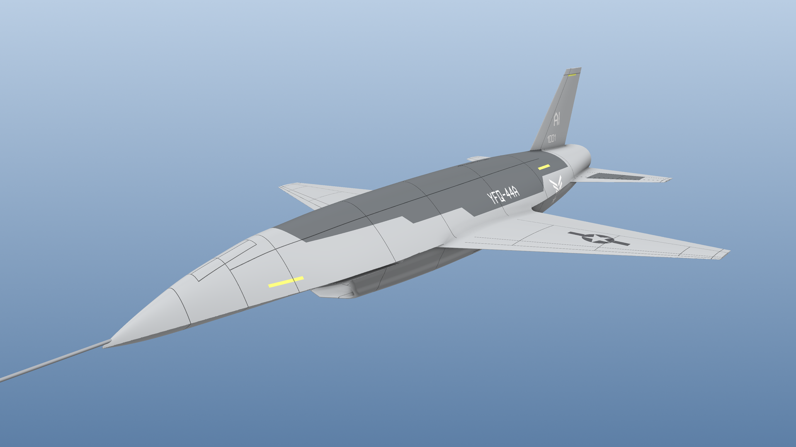
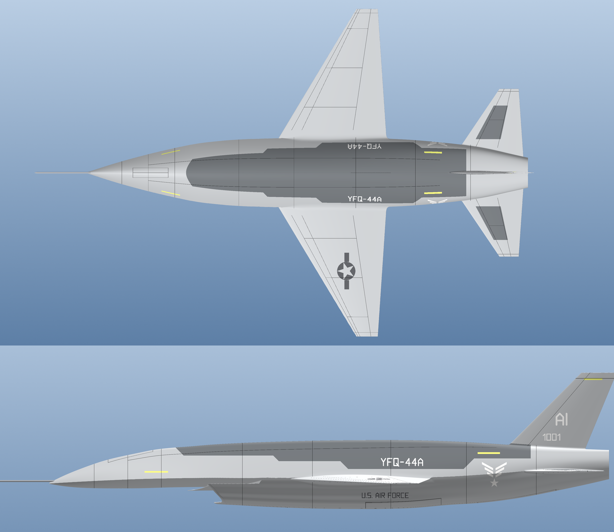
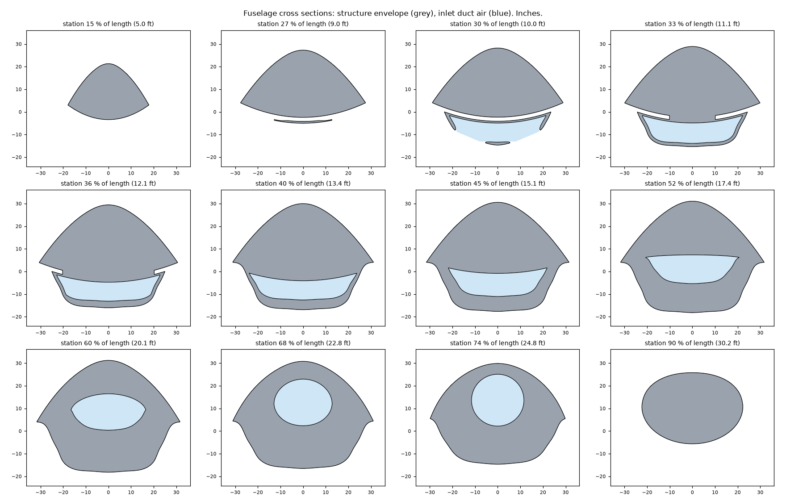
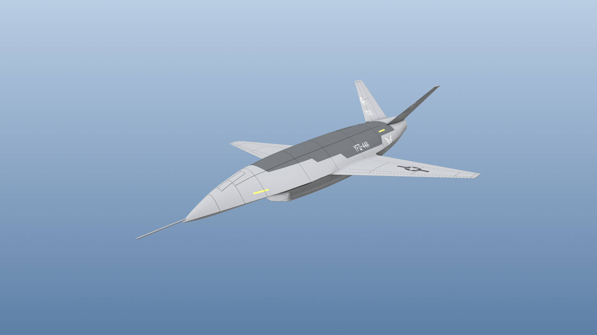

# Fury YFQ-44A: parametric aircraft with structure, fuel and livery

**Built with Claude Code.**

A parametric implicit model of a Fury-class collaborative combat aircraft, lofted with Spline DF sections and matched
to public photographs. It replaces the earlier "Fury RC: finite trailing-edge geometry" package: the notebook is now
organised to be read top to bottom by someone new to nTop, every design dimension is an input in aircraft units, and
it carries structure, fuel, panel lines and a US Air Force paint scheme.

## What the package does

- **Outer mold line** from Spline DF lofts on guide curves: arch upper fuselage with a chine, forebody underside, inlet
  cowl with a chevron lower lip, S-duct to a round engine face, jet pipe, wing, tail, fillets, control-surface gaps.
- **Inlet with a boundary-layer diverter:** arrowhead splitter plate, diverter slot and the wedge that closes it.
- **Tail switch:** conventional tail or V-tail by one input.
- **Structure and systems:** skin shell, ring frames and bulkheads, wing and tail spars and ribs, engine envelope,
  jet pipe, mission bay. A representative layout, not a stressed design.
- **Fuel:** three fuselage cells and a wing cell packed to the structure.
- **Panel lines and paint:** grooves at frames, spars, ribs and doors; two-grey scheme with lettering, national
  insignia and formation lights, all built from fields.
<!--COUNTS-->
- 19 bodies, 390 variables in 22 sections, every section with a description, no block uses anything defined below it.
<!--/COUNTS-->

## Installation and use

1. Download the package files and keep them together.
2. Open `fury-rc-finite-edges.ntop` in nTop 6.3 or later. The application and license are not included.
3. Read [docs/guide.md](docs/guide.md) once: it explains the notebook section by section.
4. Save a working copy, then change inputs in sections 01 to 05. Set `Tail type` to 1 for the V-tail.
5. The outside is shown when the notebook opens. Hide the skin and paint bodies in section 40 to see the structure,
   engine and fuel.

To mesh or export the outside, use the variable "Outer mold line" (section 16) with a tolerance near 0.4 in (10 mm).
The skin is 0.12 in thick and the paint layers are thinner still; meshing those needs a much finer tolerance.

## Inputs and outputs

| Direction | Contents |
|---|---|
| Input | Design inputs in ft, in, deg and % (sections 01 to 05): [docs/inputs.md](docs/inputs.md) |
| Input | Guide curves of the fuselage (section 10): edit their control points to reshape it |
| Output | 19 implicit bodies (section 40): skin, frames, spars, ribs, tail structure, engine, jet pipe, four fuel cells, mission bay, boom, duct air, panel lines, paint, markings, lights |
| Output | "Outer mold line" (section 16): the whole outside as one field, for meshing and export |

## How close it is to the real aircraft

<!--MATCH-->
| Check | Result |
|---|---|
| Side view, USAF photograph 07 | silhouette overlap 97.6 %, outline within one pixel of the photograph (median) and 0.33 % of the length (90 % of the outline) |
| Plan view, Anduril photograph 01 (oblique) | silhouette overlap 90.9 %, outline within 0.28 % of the length (median) and 1.56 % of the length (90 % of the outline) |
| Size | 33.5 ft long, 24.85 ft span, from the AIM-120 carried in photograph 07 (no dimensions are published) |
<!--/MATCH-->

No dimensions of the aircraft are published; the size comes from a missile of known length in a US Air Force
photograph. Method, overlays and limits: [docs/match.md](docs/match.md), [docs/proportions.md](docs/proportions.md).
Photograph sources and credits: [docs/sources.md](docs/sources.md). The photographs themselves are not included.

Not from photographs: the V-tail (a hypothetical variant) and everything inside. Estimated: diverter slot height and
splitter plate thickness. Representative: the panel line layout; lettering is a plain stroke font; the manufacturer's
logo is not reproduced and a plain star with wing bars stands in for the Air Force symbol. Not modelled: landing gear
(door outlines only), pylons and stores, antennas.

## Analysis (estimates)

<!--ANALYSIS-->
- **Weights of the modelled items:** structure 1,095 lb, engine and jet pipe 692 lb, usable fuel 734 US gal = 4,926 lb (packing limit of the bays). Full fuel 6,712 lb with the centre of gravity at station 19.03 ft (47 % of the mean aerodynamic chord); no landing gear, systems or payload are in these numbers. Wetted area 797 ft2, reference wing 143.9 ft2.
- **Inlet duct:** capture 330 in2, throat 330 in2, engine face 418 in2 (face / throat 1.27), 7.6 face diameters long, centreline rise 21.9 in, 0 % of the engine face visible straight through the inlet.
- **Vortex lattice (lifting surfaces only, Mach 0):** conventional: lift slope 0.0747 per deg, neutral point at station 19.02 ft (47 % MAC); none: lift slope 0.0662 per deg, neutral point at station 17.77 ft (28 % MAC); vee: lift slope 0.0730 per deg, neutral point at station 18.84 ft (44 % MAC).
- **Flow solution (lattice Boltzmann, half model, inlet and nozzle faired over):** alpha 0 deg: CL 0.118, CD 0.0361, Cm -0.004, alpha 4 deg: CL 0.331, CD 0.0544, Cm +0.024. Lift slope 0.0533 per deg, neutral point at station 16.64 ft. See the note in `docs/analysis.md` on which geometry revision was run.
- **The two aerodynamic estimates do not agree:** the vortex lattice (wing and tail only, no fuselage) gives a lift slope of 0.0747 per deg and a neutral point at station 19.02 ft; the flow solution of the whole aircraft gives 0.0533 per deg and station 16.64 ft, 2.4 ft (35 % of the mean aerodynamic chord) further forward. A long, wide forebody with chines does move the neutral point forward, but the flow solution is two angles on one grid with no grid study, so neither number is settled. The full-fuel centre of gravity of the modelled items (station 19.03 ft) is at the lattice neutral point and 35 % of the chord behind the flow-solution one: as modelled, with every bay full and no landing gear, systems or payload, the aircraft is not shown to be statically stable. Treat the centre of gravity and stability as open.
- **Notebook against the Python model:** the outer mold line was meshed in nTop at a tolerance of 0.47 in and the Python field evaluated at every mesh vertex. Conventional tail (the final shape with diverter and splitter plate): 5.1 M triangles, 99 % of the vertices within 1.9 thousandths of an inch of the Python field, largest difference 0.09 in. V-tail (before the diverter and splitter plate were added): 5.0 M triangles, 99 % of the vertices within 1.9 thousandths of an inch of the Python field, largest difference 0.09 in. Panel grooves and paint films are not part of the outer mold line and were not meshed in nTop.
<!--/ANALYSIS-->

Details and assumptions: [docs/analysis.md](docs/analysis.md).

## Files

- [fury-rc-finite-edges.ntop](fury-rc-finite-edges.ntop): the notebook
- [docs/guide.md](docs/guide.md): guide for someone new to nTop
- [docs/inputs.md](docs/inputs.md), [docs/match.md](docs/match.md), [docs/analysis.md](docs/analysis.md), [docs/sources.md](docs/sources.md), [docs/proportions.md](docs/proportions.md)
- `model/`, `tools/`, `analysis/`: the Python source the notebook is generated from (`python tools/build_native.py`; needs numpy, torch, pyvista, pillow and an nTop 6.3 installation for the conversion). You do not need it to use the notebook. `tools/match.py` and `tools/write_docs.py` also need the reference photographs, which are not included.
- `native/notebook/`: the recipe the notebook was converted from, the section layout and the check values
- [publication-checks.json](publication-checks.json): notebook hash, section counts, native meshing comparison

## Evidence

The notebook was written by `ntopcl convert` from the recipe, then given sections, descriptions and colours by a pass
that compares the computation before and after. The outer mold line was meshed in nTop for both tail types and compared
with the Python model at every mesh vertex (numbers above and in `publication-checks.json`).

This is an independent model made from public photographs for teaching nTop. It is not affiliated with or endorsed by
Anduril Industries or the US Air Force, and it contains no manufacturer data.

## License

MIT. See [LICENSE](LICENSE). The license covers the notebook, the source and the documents in this package.
