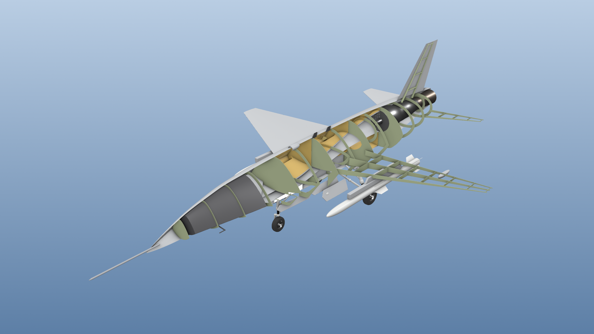
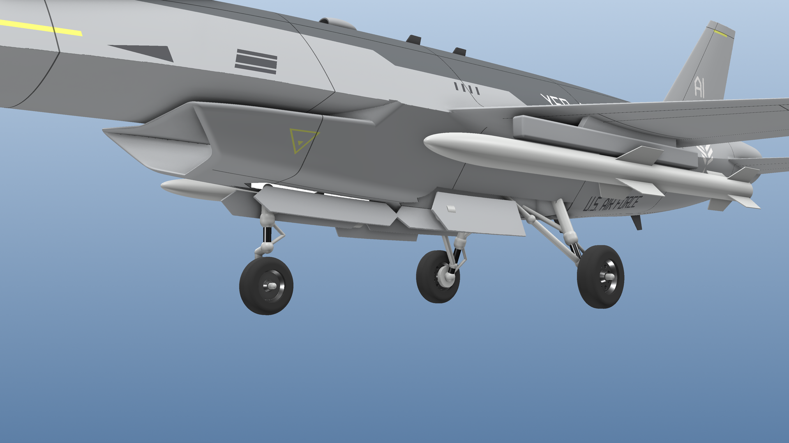
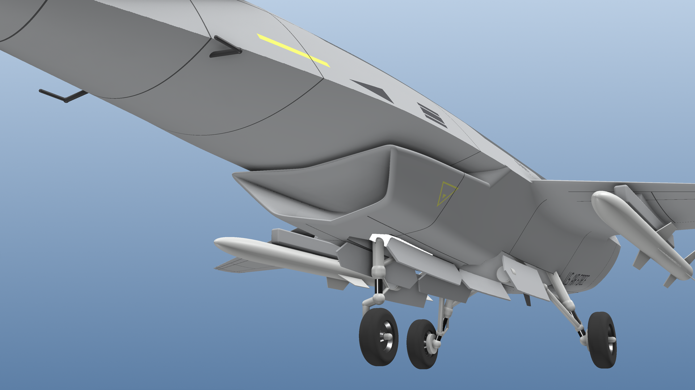
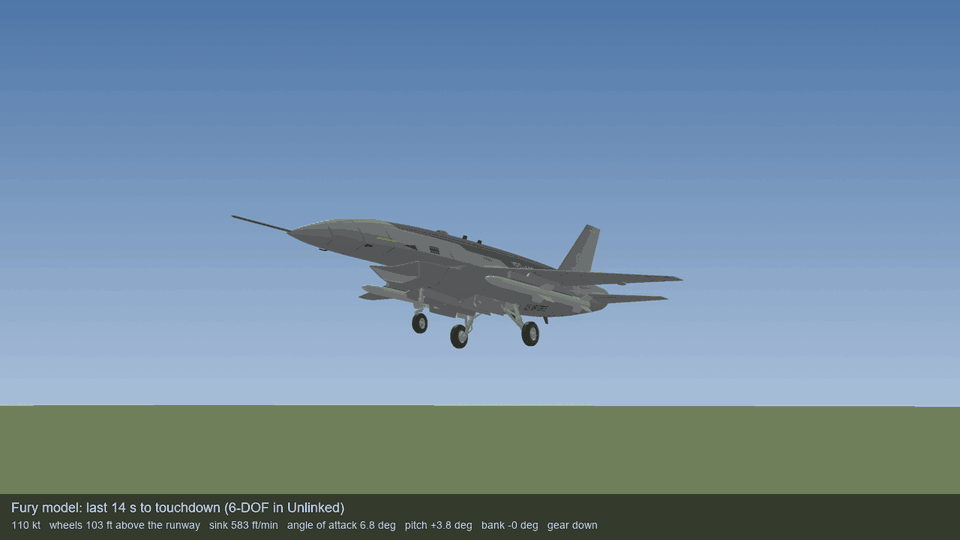
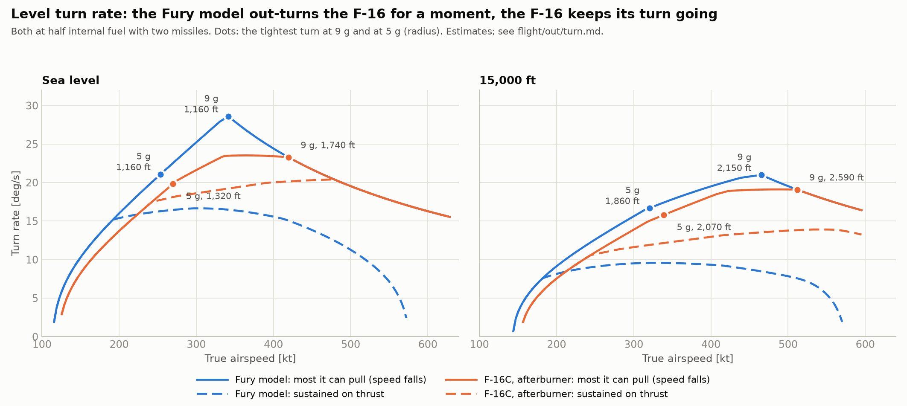
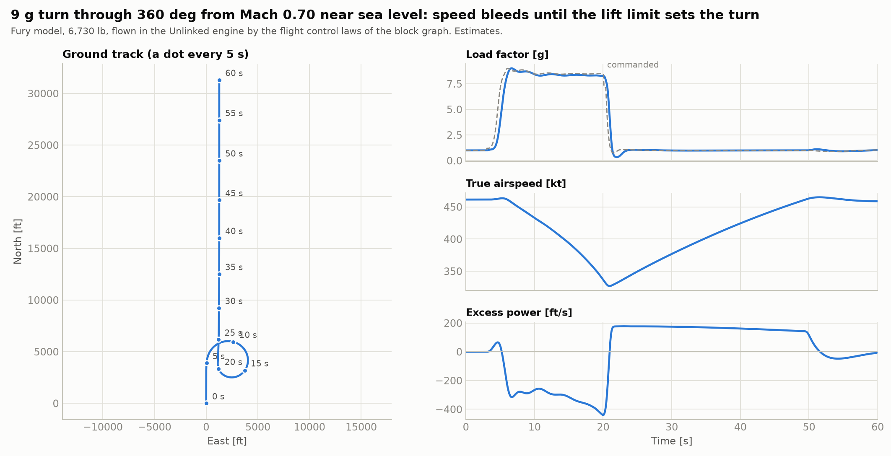

# Fury YFQ-44A: parametric aircraft with structure, fuel and livery

**Built with Claude Code.**

A parametric implicit model of a Fury-class collaborative combat aircraft, lofted with Spline DF sections and matched
to public photographs. It replaces the earlier "Fury RC: finite trailing-edge geometry" package: the notebook is now
organised to be read top to bottom by someone new to nTop, every design dimension is an input in aircraft units, and
it carries landing gear, structure, fuel, panel lines and a US Air Force paint scheme.

## What the package does

- **Outer mold line** from Spline DF lofts on guide curves: arch upper fuselage with a chine, forebody underside,
  V-hull cowl with a keel and a leaning inlet face, S-duct to a round engine face, jet pipe, wing, tail, fillets,
  control-surface gaps.
- **Inlet with a boundary-layer diverter:** blunt splitter plate (the upper lip, a shallow V), diverter slot, rounded
  cowl shoulder and the wedge that closes the slot. The inlet face is two leaning facets creased on the centreline.
- **Landing gear,** down or retracted by one input: legs, struts, wheels, bays cut into the underside, sawtooth doors.
  Placed and sized from photographs; it does not fold.
- **External fittings:** pylon, launch rail and missile-sized dummy under each wing (one input removes them), flap
  actuator fairings, dorsal scoop, antennas, air data probes.
- **Tail switch:** conventional tail or V-tail by one input.
- **Structure and systems:** skin shell, ring frames and bulkheads, wing and tail spars and ribs, engine envelope,
  jet pipe, mission bay. A representative layout, not a stressed design.
- **Fuel:** three fuselage cells and a wing cell packed to the structure, clear of the gear bays.
- **Panel lines and paint:** grooves at frames, spars, ribs and doors; two-grey scheme with lettering, national
  insignia and formation lights, all built from fields.
<!--COUNTS-->
- 30 bodies, 635 variables in 24 sections, every section with a description, no block uses anything defined below it.
<!--/COUNTS-->

## Installation and use

1. Download the package files and keep them together.
2. Open `fury-rc-finite-edges.ntop` in nTop 6.3 or later. The application and license are not included.
3. Read [docs/guide.md](docs/guide.md) once: it explains the notebook section by section.
4. Save a working copy, then change inputs in sections 01 to 06. Set `Tail type` to 1 for the V-tail, `Landing gear` to 0
   for gear up, `Wing stores` to 0 for the clean wing.
5. The outside is shown when the notebook opens. Hide the skin and paint bodies in section 40 to see the structure,
   engine and fuel.

To mesh or export the outside, use the variable "Outer mold line" (section 16) with a tolerance near 0.4 in (10 mm).
The skin is 0.12 in thick and the paint layers are thinner still; meshing those needs a much finer tolerance.

## Inputs and outputs

| Direction | Contents |
|---|---|
| Input | Design inputs in ft, in, deg and % (sections 01 to 06): [docs/inputs.md](docs/inputs.md) |
| Input | Guide curves of the fuselage (section 10): edit their control points to reshape it |
| Output | Implicit bodies (section 40): skin, frames, spars, ribs, tail structure, engine, jet pipe, four fuel cells, mission bay, boom, duct air, landing gear, doors, external fittings, panel lines, paint, markings, lights |
| Output | "Outer mold line" (section 16): the whole outside as one field, for meshing and export |

## How close it is to the real aircraft

<!--MATCH-->
| Check | Result |
|---|---|
| Side view, USAF photograph 07 | silhouette overlap 97.5 %, outline within one pixel of the photograph (median) and 0.40 % of the length (90 % of the outline) |
| Plan view, Anduril photograph 01 (oblique) | silhouette overlap 90.9 %, outline within 0.27 % of the length (median) and 1.56 % of the length (90 % of the outline) |
| Size | 33.5 ft long, 24.85 ft span, from the AIM-120 carried in photograph 07 (no dimensions are published) |
<!--/MATCH-->

No dimensions of the aircraft are published; the size comes from a missile of known length in a US Air Force
photograph. Method, overlays and limits: [docs/match.md](docs/match.md), [docs/proportions.md](docs/proportions.md).
Photograph sources and credits: [docs/sources.md](docs/sources.md). The photographs themselves are not included.

Not from photographs: the V-tail (a hypothetical variant) and everything inside. Estimated: diverter slot height and
splitter plate thickness, and the V of the upper lip, the keel of the cowl and the crease of the inlet face (read from one
photograph); landing gear, doors and external fittings are measured from photographs and good to a few
inches. Representative: the panel line layout; lettering is a plain stroke font; the manufacturer's logo is not
reproduced and a plain star with wing bars stands in for the Air Force symbol. Not modelled: gear retraction and
stowage (the nose bay under the duct is only a few inches deep), wing-tip lights, small access panels.

## Analysis (estimates)

<!--ANALYSIS-->
- **Weights of the modelled items:** structure 1,136 lb, engine and jet pipe 692 lb, landing gear 286 lb (an assumed 4 % of the full weight), usable fuel 749 US gal = 5,026 lb (packing limit of the bays). Full fuel 7,139 lb with the centre of gravity at station 19.50 ft (54 % of the mean aerodynamic chord); no systems, payload or stores are in these numbers. Wetted area 830 ft2, reference wing 143.9 ft2.
- **Inlet duct:** capture 359 in2, throat 322 in2, engine face 418 in2 (face / throat 1.30), 6.7 face diameters long, centreline rise 20.2 in, 0 % of the engine face visible straight through the inlet.
- **Vortex lattice (lifting surfaces only, Mach 0):** conventional: lift slope 0.0745 per deg, neutral point at station 18.99 ft (47 % MAC); none: lift slope 0.0662 per deg, neutral point at station 17.77 ft (28 % MAC); vee: lift slope 0.0730 per deg, neutral point at station 18.83 ft (44 % MAC).
- **Flow solution (lattice Boltzmann, half model, inlet and nozzle faired over):** alpha 0 deg: CL -0.019, CD 0.0099, Cm +0.043, alpha 4 deg: CL 0.224, CD 0.0197, Cm +0.051, alpha 8 deg: CL 0.477, CD 0.0540, Cm +0.040, alpha 12 deg: CL 0.717, CD 0.1135, Cm +0.024. Lift slope 0.0613 per deg, neutral point at station 17.72 ft. See the note in `docs/analysis.md` on which geometry revision was run.
- **The two aerodynamic estimates do not agree:** the vortex lattice (wing and tail only, no fuselage) gives a lift slope of 0.0745 per deg and a neutral point at station 18.99 ft; the flow solution of the whole aircraft gives 0.0613 per deg and station 17.72 ft, 1.3 ft (19 % of the mean aerodynamic chord) further forward. A long, wide forebody with chines does move the neutral point forward, and the flow solution has the fuselage where the lattice has none; it is one grid with no grid study, so neither number is settled. (Flow numbers published before 15 November 2026 were void: the body mesh had wrongly turned triangles along the sharp edges, which made the solver treat air behind the wing trailing edge as solid.) The full-fuel centre of gravity of the modelled items (station 19.50 ft) is 7 % of the chord behind the lattice neutral point and 26 % of the chord behind the flow-solution one: as modelled, with every bay full and no systems or payload, the aircraft is not shown to be statically stable. Treat the centre of gravity and stability as open.
- **Notebook against the Python model:** the outer mold line was meshed in nTop at a tolerance of 0.47 in and the Python field evaluated at every mesh vertex. Conventional tail (the final shape): 5.2 M triangles, 99 % of the vertices within 1.9 thousandths of an inch of the Python field, largest difference 0.12 in. V-tail (the final shape): 5.2 M triangles, 99 % of the vertices within 1.7 thousandths of an inch of the Python field, largest difference 0.12 in. The gear bays, landing gear, fittings, panel grooves and paint films are not part of the outer mold line and were not meshed in nTop.
<!--/ANALYSIS-->

Details and assumptions: [docs/analysis.md](docs/analysis.md).

## Flight study (estimates)

A 6-DOF model of the aircraft (1,203 blocks, 24 states) flown in the open-source
[Unlinked](https://github.com/CosmicFrontierLabs/unlinked) engine, and level-turn performance against an F-16C reference
built from public data. Weights, thrust, lift and drag are all estimated on this model; nothing is manufacturer data.

- **Turns at sea level, 6,730 lb (half fuel, two missiles):** the tightest 9 g turn is at 342 kt: radius 1,160 ft,
  29 deg/s, losing 19 kt/s; the model sustains 5.9 g at most. The tightest 5 g turn: 1,160 ft at 254 kt, sustained from
  324 kt (1,900 ft). F-16C reference in afterburner: 9 g at 419 kt, 1,740 ft, sustained from 480 kt.
- **Power coming out of the turn:** about +170 ft/s of excess power at 1 g after the 9 g turn, against about
  +800 ft/s for the F-16C reference.
- **9 g turn through 180 deg in the 6-DOF model, from Mach 0.70 at 1,000 ft:** 10.4 s, radius 2,000 ft, speed 461 to
  410 kt, 12 s to regain the entry speed.
- **Landing approach, 4,970 lb, gear and flap down:** 3 deg final at 110 kt, 583 ft/min, angle of attack 6.9 deg;
  touchdown at 96 kt, 3.4 ft/s.

Tables, more pictures, method, checks and limits: [flight/README.md](flight/README.md).

## Files

- [fury-rc-finite-edges.ntop](fury-rc-finite-edges.ntop): the notebook
- [AGENTS.md](AGENTS.md): instructions for an AI coding agent making a variant of this model
- [docs/guide.md](docs/guide.md): guide for someone new to nTop
- [docs/inputs.md](docs/inputs.md), [docs/match.md](docs/match.md), [docs/analysis.md](docs/analysis.md), [docs/sources.md](docs/sources.md), [docs/proportions.md](docs/proportions.md)
- `model/`, `tools/`, `analysis/`: the Python source the notebook is generated from (`python tools/build_native.py`; needs numpy, torch, scipy, matplotlib, pyvista, pillow and an nTop 6.3 installation for the conversion). You do not need it to use the notebook. `tools/match.py` and `tools/write_docs.py` also need the reference photographs, which are not included.
- [flight/README.md](flight/README.md), `flight/`: the flight study: aircraft as numbers, turn performance, the 6-DOF block graph
  `flight/sim/model/fury_6dof.mdl` for Unlinked, the flights and their results
- `native/notebook/`: the recipe the notebook was converted from, the section layout and the check values
- [publication-checks.json](publication-checks.json): notebook hash, section counts, native meshing comparison

## Evidence

The notebook was written by `ntopcl convert` from the recipe, then given sections, descriptions and colours by a pass
that compares the computation before and after. The outer mold line was meshed in nTop for both tail types and compared
with the Python model at every mesh vertex (numbers above and in `publication-checks.json`).

This is an independent model made from public photographs for teaching nTop. It is not affiliated with or endorsed by
Anduril Industries or the US Air Force, and it contains no manufacturer data.

## License

MIT. See [LICENSE](LICENSE). The license covers the notebook, the source and the documents in this package.
