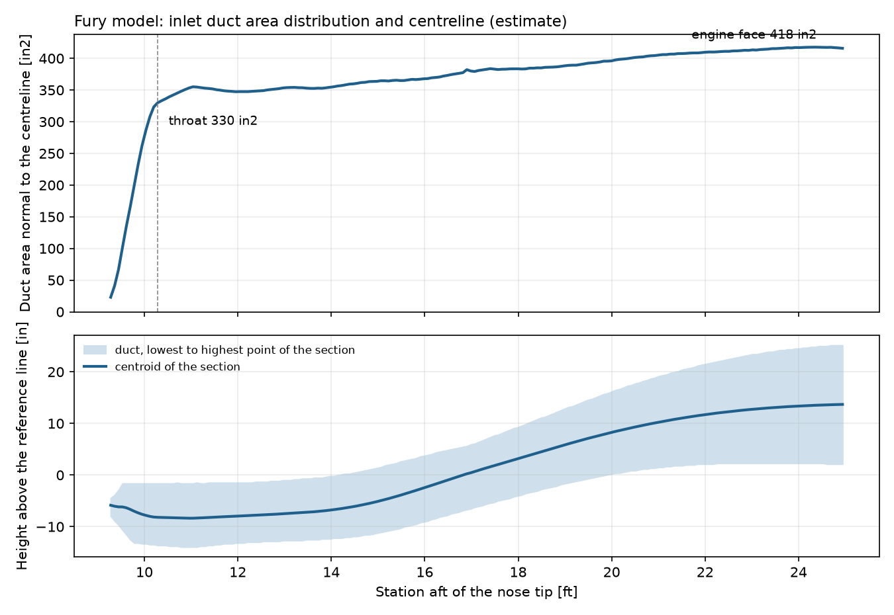

# Analysis results

All numbers are estimates made on the model, in US customary units. Scripts are in `analysis/`; the json beside each result keeps SI values.

## Weights, fuel and centre of gravity (estimate)

Bodies of the model with assumed densities. The structure is a representative layout, not a stressed design: read these as
first estimates. Stations are measured aft of the nose tip.

- Length 33.5 ft, span 24.85 ft, wetted area 830 ft2, enclosed volume 297 ft3
- Reference wing (input trapezoid to the centreline): area 143.9 ft2, aspect ratio 4.29, taper 0.165, mean aerodynamic chord 6.78 ft with its leading edge at station 15.84 ft

| Body | Volume [ft3] | Weight [lb] | Station of centroid [ft] | Height [in] | Basis |
|---|---:|---:|---:|---:|---|
| Skin | 8.30 | 829 | 19.71 | 6.4 | wetted area x skin thickness |
| Fuselage frames | 1.20 | 207 | 18.30 | 7.1 | 173 lb/ft3 |
| Wing spars | 0.31 | 54 | 18.24 | 3.7 | 173 lb/ft3 |
| Wing ribs | 0.17 | 30 | 18.96 | 3.7 | 173 lb/ft3 |
| Tail structure | 0.10 | 17 | 30.51 | 22.2 | 173 lb/ft3 |
| Engine | 13.50 | 650 | 27.24 | 13.7 | published dry weight, placed at the centroid of the envelope |
| Jet pipe | 0.15 | 42 | 32.10 | 13.7 | 277 lb/ft3 |
| Forward fuselage fuel | 32.88 | 1452 | 13.64 | 11.2 | usable fuel = cell volume x usable fraction |
| Centre fuselage fuel | 29.67 | 1310 | 17.95 | 13.2 | usable fuel = cell volume x usable fraction |
| Aft fuselage fuel | 41.49 | 1833 | 22.67 | 3.7 | usable fuel = cell volume x usable fraction |
| Wing fuel | 9.75 | 430 | 18.73 | 4.1 | usable fuel = cell volume x usable fraction |
| Mission systems bay | 19.34 | 0 | 6.39 | 8.9 | space, no weight assigned |
| Inlet duct air | 40.16 | 0 | 17.49 | 2.7 | space, no weight assigned |
| Landing gear (legs, wheels, tyres, doors) | 3.37 | 286 | 17.72 | -30.8 | assumed 4 % of the weight with full fuel |

| Total | Weight [lb] | Centre of gravity station [ft] | % of mean aerodynamic chord |
|---|---:|---:|---:|
| Structure (skin, frames, spars, ribs) | 1136 | 19.52 | 54 |
| Engine and jet pipe | 692 | 27.53 | 172 |
| Landing gear (assumed 4 % of full weight) | 286 | 17.72 | 28 |
| Usable fuel (749 US gal) | 5026 | 18.49 | 39 |
| Modelled items, no fuel | 2114 | 21.90 | 89 |
| Modelled items, full fuel | 7139 | 19.50 | 54 |

Fuel cells hold 851 US gal geometric volume; 88 % is counted usable: 5026 lb of JP-8.
This is the packing limit of the model: every fuselage bay between the tank bulkheads is filled except the landing gear bays, and so is the wing box.
A real aircraft gives more of that space to systems and weapons, so its fuel load is lower.
The landing gear is not weighed from its bodies: it is an assumed 4 % of the weight with full fuel, placed at the centroid of the gear bodies.
Systems, mission equipment, pylons and stores are not weighed, so the centre of gravity above is of the modelled items only.
With the reported 4000 lbf engine, thrust / weight of the modelled items at full fuel is 0.56.
The 5,000 lb maximum take-off weight often quoted for the Fury goes with the 20 ft by 17 ft size quoted for the earlier design; it is not used here
because the photographs give a 33.5 ft aircraft (docs/proportions.md).

Assumptions: skin_density = 1600.0, structure_density = 2770.0, jet_pipe_density = 4430.0, fuel_density = 804.0, usable_fuel_fraction = 0.88, engine_weight_lb = 650.0, landing_gear_fraction = 0.04, engine_thrust_lbf = 4000.0.

## Inlet duct (estimate)

Cuts of the duct air body of the model. Areas are normal to the duct centreline. Mach numbers are one-dimensional, isentropic, for an assumed
Mach number at the engine face; no losses, boundary layer or distortion.

| Quantity | Value |
|---|---:|
| Lower lip station | 9.78 ft |
| Throat station | 12.13 ft |
| Engine face station | 24.96 ft |
| Capture area (largest section at the lip, seen from the front) | 359 in2 |
| Throat area | 322 in2 (50.4 in wide, 10.2 in high) |
| Engine face area | 418 in2 (23.1 in diameter) |
| Capture area / throat area | 1.12 |
| Engine face area / throat area | 1.30 |
| Length, throat to engine face | 12.83 ft = 6.7 face diameters |
| Centreline rise, throat to engine face | 20.2 in = 0.13 of the length |
| Steepest centreline slope | 14 deg |
| Engine face seen straight through the inlet | 0 % |

| Condition | Engine face Mach (assumed) | Air flow [lb/s] | Throat Mach | Stream tube / capture area |
|---|---:|---:|---:|---:|
| Sea level, static | 0.35 | 81 | 0.48 | static |
| Sea level, static | 0.45 | 99 | 0.67 | static |
| Sea level, static | 0.55 | 114 | choked | static |
| Sea level, Mach 0.3 | 0.35 | 85 | 0.48 | 1.33 |
| Sea level, Mach 0.3 | 0.45 | 104 | 0.67 | 1.64 |
| Sea level, Mach 0.3 | 0.55 | 121 | choked | 1.89 |
| 35,000 ft, Mach 0.85 | 0.35 | 33 | 0.48 | 0.67 |
| 35,000 ft, Mach 0.85 | 0.45 | 40 | 0.67 | 0.82 |
| 35,000 ft, Mach 0.85 | 0.55 | 46 | choked | 0.95 |

## Lift and stability by vortex lattice (estimate)

Flat lifting surfaces from the planform inputs. No fuselage volume, thickness or camber: the fuselage moves the real neutral point forward
and reduces the real directional stability, so read the numbers as a comparison of the two tails and a first estimate.

Reference: wing area 143.9 ft2, span 24.85 ft, mean aerodynamic chord 6.78 ft, its leading edge at station 15.84 ft.

| Tail | Area [ft2] | Arm [ft] | Volume coefficient |
|---|---:|---:|---:|
| Horizontal tail (both sides) | 48.8 | 12.3 | 0.61 |
| Fin | 17.3 | 12.5 | 0.060 |
| V-tail (both panels, cant 47 deg) | 49.0 | 12.6 | horizontal 0.29, vertical 0.092 |

| Mach | Configuration | Lift slope [per deg] | Neutral point station [ft] | Neutral point [% MAC] | Cn beta of the lifting surfaces [per rad] | CY beta [per rad] |
|---:|---|---:|---:|---:|---:|---:|
| 0.0 | Wing alone | 0.0662 | 17.77 | 28 | -0.000 | -0.001 |
| 0.0 | Conventional tail | 0.0745 | 18.99 | 47 | -0.120 | -0.236 |
| 0.0 | V-tail | 0.0730 | 18.83 | 44 | -0.176 | -0.340 |
| 0.6 | Wing alone | 0.0744 | 17.80 | 29 | -0.000 | -0.002 |
| 0.6 | Conventional tail | 0.0823 | 18.88 | 45 | -0.126 | -0.249 |
| 0.6 | V-tail | 0.0814 | 18.81 | 44 | -0.185 | -0.358 |

Centre of gravity of the modelled items (structure, engine, landing gear, fuel; no systems or stores) from analysis/results/mass.md:
full fuel at station 19.50 ft, no fuel at station 21.90 ft.
- Conventional tail: lattice neutral point is -7 % MAC aft of the full-fuel point and -43 % MAC aft of the no-fuel point (positive = stable, before the fuselage effect).
- V-tail: lattice neutral point is -10 % MAC aft of the full-fuel point and -45 % MAC aft of the no-fuel point (positive = stable, before the fuselage effect).

## Flow solution of the closed flow body (estimate)

A GPU flow solver: incompressible lattice Boltzmann with a wall-modelled turbulence closure, half model, inlet and nozzle faired over,
conventional tail, no control deflection. Reynolds number of Mach 0.5 at 15000 ft (313 kt, dynamic pressure 209 lb/ft2); the solution itself is Mach 0. Coefficients are the surface quadrature of pressure and shear,
on wing area 143.9 ft2 and mean aerodynamic chord 6.78 ft, moments about its quarter point (station 17.53 ft).

| Angle of attack [deg] | CL | CD | Cm | Lift at this dynamic pressure [lbf] | L/D | Cells | Run time [min] |
|---:|---:|---:|---:|---:|---:|---:|---:|
| 0 | -0.0190 | 0.0099 | +0.0434 | -572 | -1.9 | 20.5 M | 25 |
| 4 | 0.2236 | 0.0197 | +0.0508 | 6725 | 11.4 | 20.2 M | 24 |
| 8 | 0.4770 | 0.0540 | +0.0398 | 14343 | 8.8 | 19.9 M | 23 |
| 12 | 0.7166 | 0.1135 | +0.0236 | 21549 | 6.3 | 19.8 M | 26 |

From the first and last angle: lift slope 0.0613 per deg, zero-lift angle +0.31 deg, dCm/dCL -0.027, neutral point at station 17.72 ft (28 % of the mean aerodynamic chord).
Drag from this solver on this grid is a rough number; lift and moment are the useful part.

The flow body is the final shape with the conventional tail; the landing gear and wing stores are not in it. One grid, no grid study. These runs replace the ones published before 15 November 2026, which were void: the body mesh had a few thousand triangles turned the wrong way along the sharp wing and tail edges (the mesh was still closed), and the solver took blocks of air behind the wing trailing edge for solid. `registry.orient_faces` now makes the orientation consistent before a body is written for a flow solver.

## The two aerodynamic estimates side by side

the vortex lattice (wing and tail only, no fuselage) gives a lift slope of 0.0745 per deg and a neutral point at station 18.99 ft; the flow solution of the whole aircraft gives 0.0613 per deg and station 17.72 ft, 1.3 ft (19 % of the mean aerodynamic chord) further forward. A long, wide forebody with chines does move the neutral point forward, and the flow solution has the fuselage where the lattice has none; it is one grid with no grid study, so neither number is settled. (Flow numbers published before 15 November 2026 were void: the body mesh had wrongly turned triangles along the sharp edges, which made the solver treat air behind the wing trailing edge as solid.) The full-fuel centre of gravity of the modelled items (station 19.50 ft) is 7 % of the chord behind the lattice neutral point and 26 % of the chord behind the flow-solution one: as modelled, with every bay full and no systems or payload, the aircraft is not shown to be statically stable. Treat the centre of gravity and stability as open.

## Notebook against the Python model

The outer mold line was meshed in nTop at a tolerance of 0.47 in and the Python field evaluated at every mesh vertex. Conventional tail (the final shape): 5.2 M triangles, 99 % of the vertices within 1.9 thousandths of an inch of the Python field, largest difference 0.12 in. V-tail (the final shape): 5.2 M triangles, 99 % of the vertices within 1.7 thousandths of an inch of the Python field, largest difference 0.12 in. The gear bays, landing gear, fittings, panel grooves and paint films are not part of the outer mold line and were not meshed in nTop.
