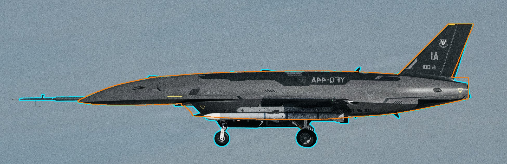

# How well the model matches the photographs

Each photograph is mapped into the model frame from a few picked points (nose tip, nozzle centre, wing tips), and the model
silhouette is drawn on it. Orange: outline of the model. Cyan: outline of the aircraft found in the photograph (against the sky).
Overlap is intersection over union of the two silhouettes; the outline distance is given in percent of the fuselage length
(1 % of length = 4 in). Landing gear, missile, pylon and nose boom are in the photographs and not in the model outline, so they
are left out of the score where a score window is set (`docs/match-views.json`).

| View | Photograph | Overlap | Outline distance, median | Outline distance, 90 % of the outline within |
|---|---|---:|---:|---:|
| plan_01 | `01_plan_underside_flight_gearup_anduril.jpg` | 0.909 | 0.27 % | 1.56 % |
| side_07 | `07_side_flight_gear_down_aim120_1001_usaf.jpg` | 0.975 | 0.00 % | 0.40 % |

## Side view

## Plan view (underside)

_The plan-view overlay is drawn on a company press photograph and is not redistributed here; the numbers are in the table above._

The plan photograph is an oblique view, so the near fuselage side and the fin show beside the planform; that is most of the
difference in the plan numbers.

## Checked by eye, not scored

- Front view (photographs 12 to 14): arch upper section, chine overhanging the cowl, wide hexagonal inlet opening (cowl walls leaning
  in at about 45 deg), 1.5 deg anhedral.
- Inlet (photographs 07, 13, 18, 19 and three photographs of the full-size exhibition aircraft): lower lip station, leaning inlet
  face in two facets creased on the centreline, the blunt V-shaped upper lip (splitter plate) under the forebody, the keel of the
  cowl, the diverter slot and the rounded shoulder of the cowl. The slot height and the plate thickness are estimates.
- Wing root (photographs 01, 04, 13): the chine runs into the wing leading edge; the wing sits at the chine height.
- Landing gear (photographs 06, 12, 13, 23): nose leg with a one-sided fork, main legs leaning outboard from the lower fuselage, single
  wheels, sawtooth doors, landing lights on the outer main doors. Sizes and positions are measured from the photographs, good to a few inches.
- External fittings (photographs 01, 06 to 08, 12, 23): pylon, launch rail and missile-sized dummy under each wing, flap actuator fairings,
  dorsal scoop, blade antennas, air data probes, grille and louvre markings.
- Paint and markings (photographs 04, 05, 06, 07, 17): two greys, designation, tail code, serial, insignia. Positions from the photographs;
  the lettering is a plain stroke font, panel lines are a representative layout at the frames, spars and doors.
- Not modelled: gear retraction and stowage, wing-tip navigation lights, small access panels, the manufacturer lettering.

Measured proportions and how the scale was found: `docs/proportions.md`.