# Fury flight study: turn performance and a 6-DOF model in Unlinked

Everything here is an estimate made on the photo-matched nTop model. No weight, thrust, lift or drag number of the
real YFQ-44A is used, because none is public beyond the engine type and the "Mach 0.95, 9 g class" statements.
Units shown are US customary; the files keep SI.

## What is in the folder

| File | What it does |
|---|---|
| `aircraft.py` | The aircraft as numbers: weights, balance, inertia, thrust, lift and drag tables, control derivatives. Writes `out/aircraft.md` (every assumption listed) |
| `lattice.py` | Vortex lattice of wing, horizontal tail and fin with control surfaces and rates: the stability and control derivatives |
| `turn.py` | Level-turn point performance against an F-16C reference model. Writes `out/turn.md` |
| `charts.py` | `out/turn_rate.png`, `out/excess_power.png`, the 6-DOF turn traces and the approach trace |
| `ref/` | F-16C reference model, engine model and the point-performance routines (from an earlier flight study by the same author) |
| `sim/model/build_model.py` | Writes the 6-DOF block graph `sim/model/fury_6dof.mdl` (1,203 blocks, 24 states) and its signal list |
| `sim/params.py` | Workspace of the model for one weight and flight condition, trimmed |
| `sim/run.py`, `sim/fly.py`, `sim/schedule.py` | Run the model in the native Unlinked engine; fly it from a schedule of commands |
| `sim/maneuvers.py` | The flights of this study: the approach and six turns. Writes `out/flights.json` |
| `sim/verify/ref6dof.py` | The same equations written a second time in Python, to check the block graph |
| `sim/MODEL_CONTRACT.md` | Axes, states, signs, units and limits of the 6-DOF model |
| `sim/unlinked_signal_option.patch` | The 17-line change to the Unlinked command-line program that this study needs (see below) |
| `sim/runs/<flight>/` | What was flown: `schedule.json`, `params.json`, `init.m`, `summary.json` and the recorded signals |
| `out/` | Results: `aircraft.md`, `turn.md`, `flights.json` (the charts and pictures shown here are `docs/img/flight-*`; the scripts write new ones to `out/`) |
| `render_approach.py` | Pictures and the animation of the approach from the 6-DOF trace |

## Run it

    PY=<python with numpy, scipy, matplotlib, pyvista>
    $PY flight/aircraft.py            # aircraft statement
    $PY flight/turn.py                # point performance, Fury against F-16
    $PY flight/sim/model/build_model.py
    $PY flight/sim/maneuvers.py approach turns --verify
    $PY flight/charts.py
    $PY flight/render_approach.py mesh && $PY flight/render_approach.py stills && $PY flight/render_approach.py film

To fly something else: write a schedule (see `sim/schedules/turn_9g.json` and the keys in `sim/schedule.py`) and run
`$PY flight/sim/fly.py --schedule <file> --verify`. Each run folder holds `init.m`: open `fury_6dof.mdl` in the
Unlinked web app with that file as the init script to run the same flight there.

### The engine

The flights run in the command-line program of [Unlinked](https://github.com/CosmicFrontierLabs/unlinked) (open source,
Apache-2.0), which reads the block graph `fury_6dof.mdl` directly. The study uses one addition to it: an option
`--signal` that keeps only the listed signals (the program otherwise records every block output and stops at 10 million
values). The change is in `sim/unlinked_signal_option.patch`; it does not touch the integration.

    git clone https://github.com/CosmicFrontierLabs/unlinked && cd unlinked
    git checkout cbae79996ff651d11a9189ffb197e172e539fbb3
    git apply <this package>/flight/sim/unlinked_signal_option.patch
    cargo build --release
    export UNLINKED_EXE=$PWD/target/release/unlinked        # unlinked.exe on Windows

Without the engine everything except `sim/maneuvers.py` and `sim/fly.py` still runs. In the published package each
flight folder holds the recorded signals at 30 Hz (`trace_30hz.npz`, every eighth solver step) in place of the full
`raw.npz`, and the charts and the approach pictures are drawn from that.

## The aircraft as modelled

| | Fury model | F-16C reference |
|---|---:|---:|
| Weight, half fuel and two missiles | 6,730 lb | 23,580 lb |
| Wing area | 143.9 ft2 | 300 ft2 |
| Wing loading | 47 lb/ft2 | 79 lb/ft2 |
| Thrust at sea level, Mach 0.5 | 3,220 lbf | 29,050 lbf (afterburner) |
| Thrust / weight there | 0.48 | 1.23 |
| Usable lift coefficient, low speed | 1.10 (assumed) | from its reference model |

## Turn performance (sea level, `out/turn.md` has 15,000 ft and the 5,000 lb case)

Tightest turn at each load factor = the lowest speed at which the wing gives that load factor.

| Load factor | Aircraft | Speed | Radius | Rate | Speed change in the turn | Sustained? | Excess power at 1 g on roll-out |
|---:|---|---:|---:|---:|---:|---|---:|
| 9 g | Fury model | 342 kt | 1,160 ft | 29 deg/s | -19 kt/s | no (5.9 g is the most it sustains) | +170 ft/s |
| 9 g | F-16C, afterburner | 419 kt | 1,740 ft | 23 deg/s | -10 kt/s | from 480 kt (2,280 ft) | +800 ft/s |
| 7 g | Fury model | 300 kt | 1,150 ft | 25 deg/s | -13 kt/s | no | +170 ft/s |
| 7 g | F-16C, afterburner | 328 kt | 1,380 ft | 23 deg/s | -17 kt/s | from 384 kt (1,880 ft) | +620 ft/s |
| 5 g | Fury model | 254 kt | 1,160 ft | 21 deg/s | -7 kt/s | from 324 kt (1,900 ft) | +155 ft/s |
| 5 g | F-16C, afterburner | 270 kt | 1,320 ft | 20 deg/s | -7 kt/s | from 291 kt (1,530 ft) | +500 ft/s |
| 3 g | Fury model | 197 kt | 1,210 ft | 16 deg/s | -1 kt/s | from 202 kt (1,270 ft) | +125 ft/s |
| 3 g | F-16C, afterburner | 211 kt | 1,390 ft | 15 deg/s | +7 kt/s | yes | +380 ft/s |

Along the lift limit the radius hardly changes with load factor (about 1,150 to 1,200 ft for the Fury model, 1,350 to 1,750 ft for
the F-16): more g at a higher speed buys turn rate, not a smaller circle.

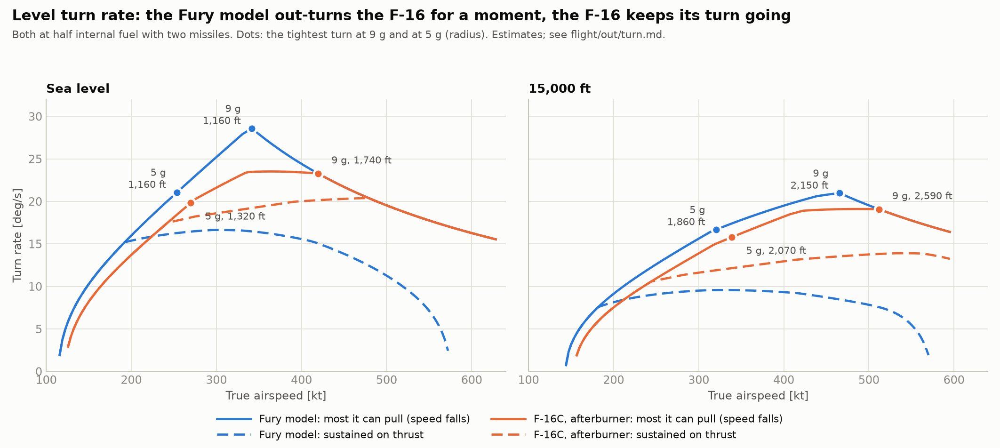

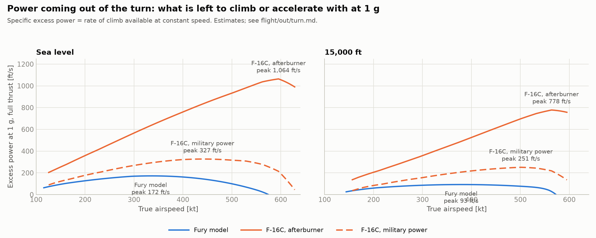

## The 6-DOF flights (flown in the native Unlinked engine)

| Flight | Result |
|---|---|
| 5 g, 360 deg, Mach 0.60 at 1,000 ft, speed held | 28 s, radius 2,850 ft, 13.5 deg/s, throttle 0.88, speed 392 to 396 kt; +160 ft/s at full thrust on roll-out |
| 7 g, 180 deg from Mach 0.70 at 1,000 ft | 12.5 s, radius 2,630 ft, speed 461 to 441 kt (-2 kt/s), -90 ft/s in the turn; +140 ft/s on roll-out, entry speed back in 5 s |
| 9 g, 180 deg from Mach 0.70 at 1,000 ft | 10.4 s, radius 2,000 ft (1,810 ft at the end), 21 deg/s, speed 461 to 410 kt (-7 kt/s), -280 ft/s in the turn; +155 ft/s on roll-out, 12 s to regain the entry speed |
| 9 g, 360 deg from Mach 0.70 at 1,000 ft | 17.6 s; speed falls to 327 kt, where the lift limit holds the turn at about 8 g, 1,200 ft radius, 27 deg/s; +175 ft/s on roll-out, 26 s to regain the entry speed |
| 9 g, 180 deg from Mach 0.80 at 15,000 ft | 10.7 s, radius 2,230 ft, speed 501 to 378 kt (-16 kt/s), -680 ft/s in the turn; +97 ft/s on roll-out, 48 s to regain the entry speed |
| 5 g, 180 deg from Mach 0.80 at 15,000 ft | 20 s, radius 4,260 ft, speed 501 to 470 kt; +88 ft/s on roll-out |
| Landing approach, 4,970 lb, gear and flap down | base turn at 30 deg of bank, 3 deg final at 110 kt, 583 ft/min, angle of attack 6.9 deg, pitch 3.9 deg, throttle 0.17; flare from 45 ft; touchdown at 96 kt, 3.4 ft/s, pitch 9.1 deg |

The 6-DOF numbers agree with the point performance where they overlap (lift-limited radius 1,200 ft against 1,160 ft; see `out/turn.md` for the
point-mass half turn).

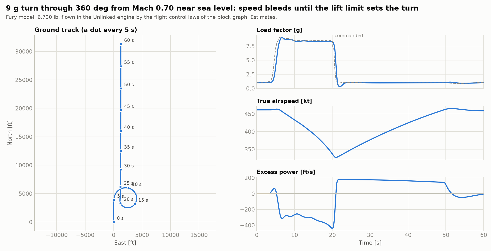

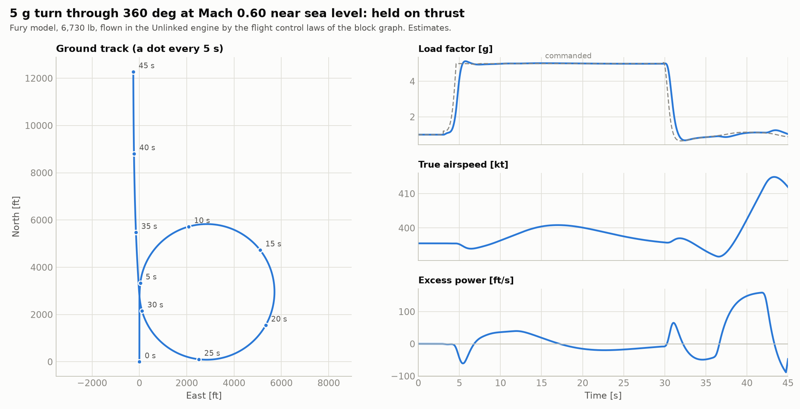

### Landing approach

The aircraft in the pictures is the notebook geometry with the gear down, placed at the position and attitude of the
6-DOF trace.

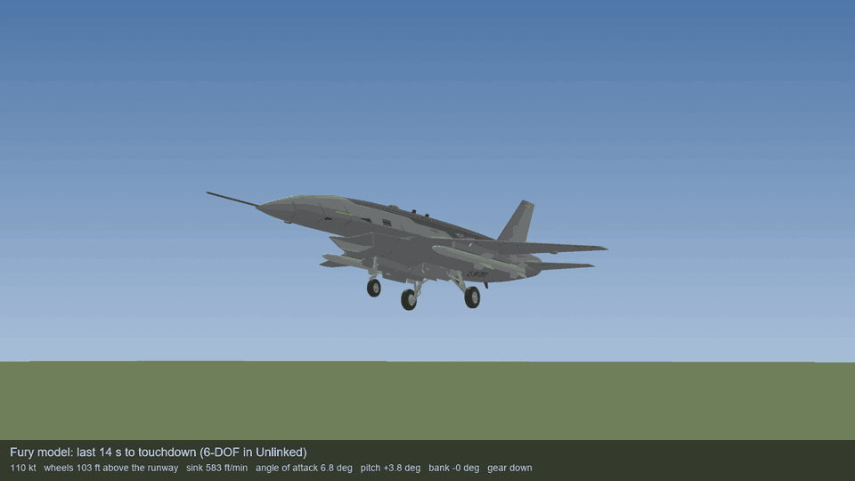

| | |
|---|---|
| 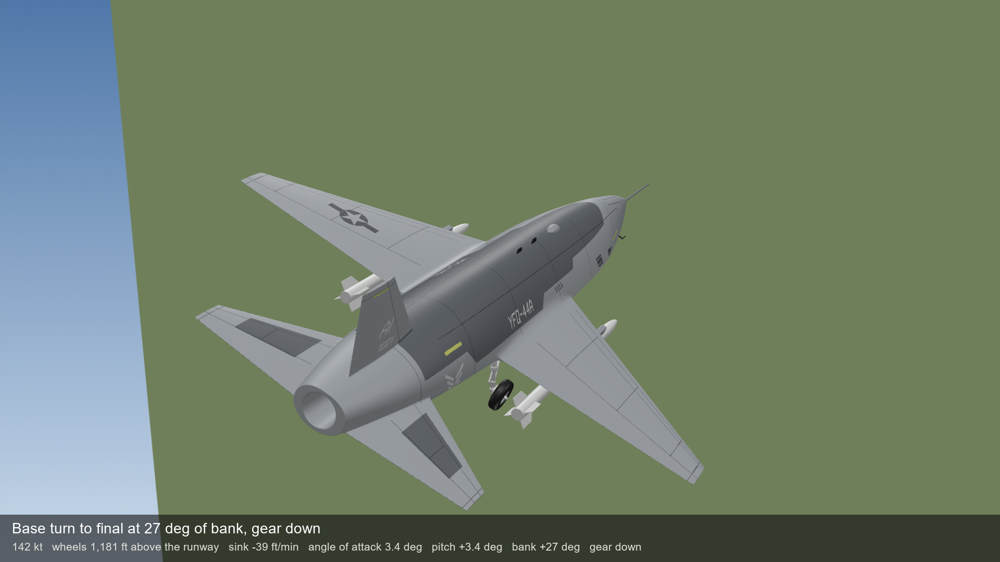 | 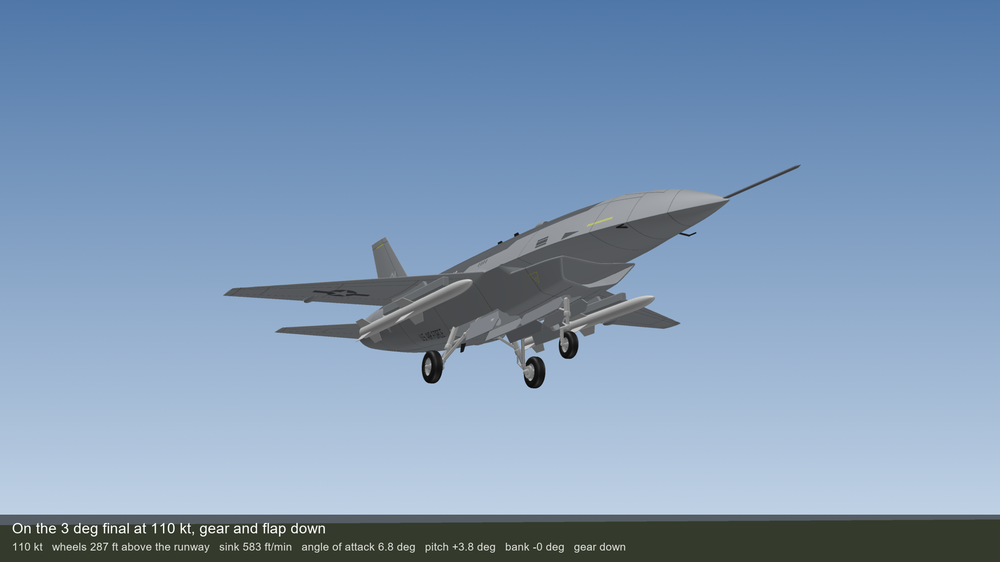 |
| 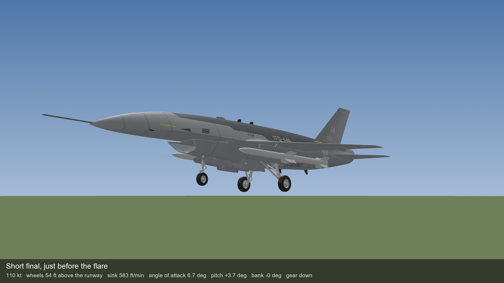 | 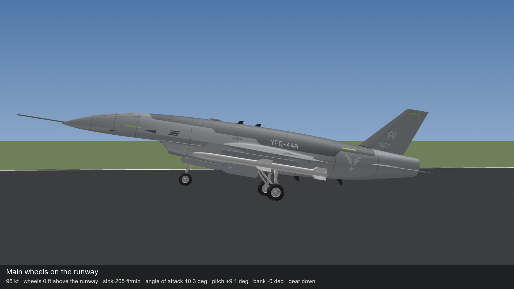 |

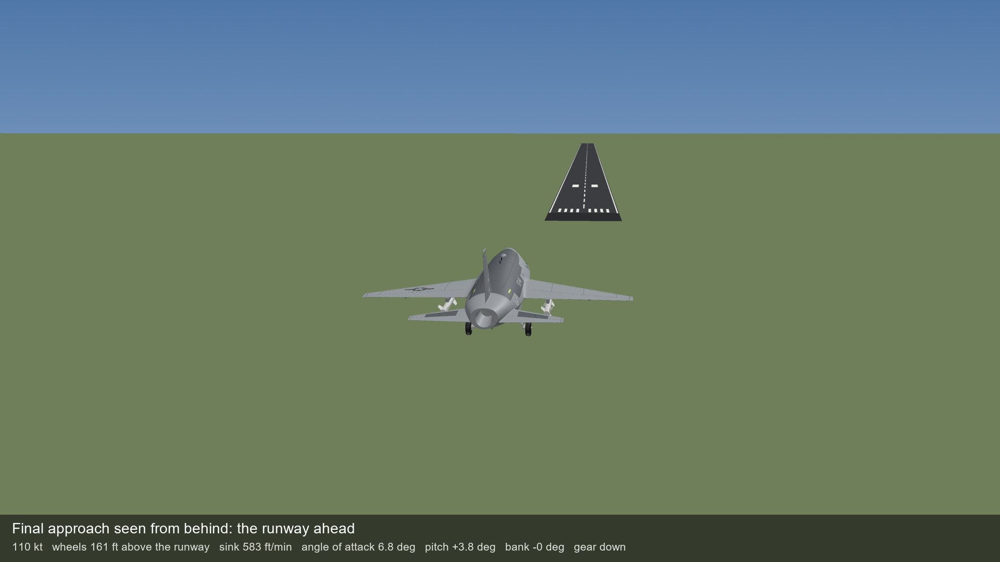

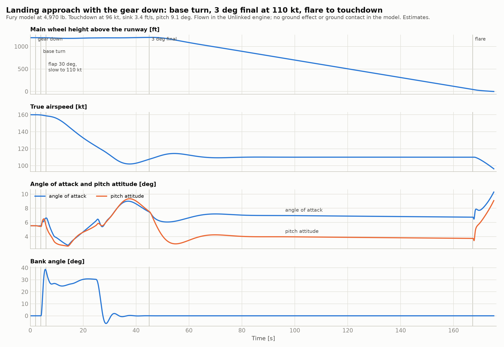

## Checks

- Every flight was repeated in the independent Python model (`sim/verify/ref6dof.py`) with the same RK4 step: largest
  difference 4e-13 of the signal scale over all compared signals.
- The 9 g 360 deg turn was also run in the local Unlinked web service (project "Fury 6-DOF flight model"): equal to
  the native engine to round-off. The approach was run there at half the sample rate: position within 0.0004 m of the
  native run, which also shows the step size is small enough.
  Both web runs were made before the flow correction of 15 November 2026; the block graph has not changed since, only
  two numbers of the workspace (lift and moment at zero angle of attack), so they were not repeated.
- Lattice against the Helmbold lift slope of the wing alone: 0.97 to 0.98 at Mach 0 to 0.8; all control and stability
  signs as expected.

## Limits (read before quoting a number)

- Weights, centre of gravity, inertia, thrust, usable lift, drag: all estimated (`out/aircraft.md`). The size of the model
  itself rests on one photograph. Thrust +/- 15 % moves the most g sustained at sea level between 5.0 and 6.8;
  usable lift coefficient +/- 0.15 moves the 9 g radius between about 1,010 and 1,380 ft.
- Drag due to lift is the weakest number. The flow solution gives about twice the model's value (0.20 CL2 against about
  0.09 CL2) with less zero-lift drag. With its drag the most g sustained at sea level is 5.3 instead of 5.9 and the
  9 g turn loses energy at 900 ft/s instead of 570 ft/s; radius and rate do not change. The solver under-resolves the
  thin leading edge at the grid run, so this is read as the pessimistic bound.
- Balance is not resolved: the neutral point is 36 % of the mean chord by the lattice of wing and tail less the
  fuselage moment (used) and 28 % by the flow solution (22 to 32 % between its angles). The flight model assumes a 5 %
  static margin, which puts the centre of gravity at 31 % or 23 %. The weight model balances well aft of both, and
  the main wheels stand further aft still.
- Lift and pitching moment at zero angle of attack come from the flow solution of the final shape (lift coefficient
  -0.02, moment +0.04). Its lift slope is 18 % below the lattice slope used here: if it is right, the angles of attack
  quoted are about a fifth too small (approach about 8.5 deg instead of 6.9 deg).
- Flow numbers quoted before 15 November 2026 (lift +0.12 or -0.29 at zero angle, neutral point at 12 %) were void: the
  flow-body mesh had wrongly turned triangles along the sharp edges and the solver took air behind the wing trailing
  edge for solid. Found in the saved flow field, repaired with `registry.orient_faces`, all flights re-flown.

  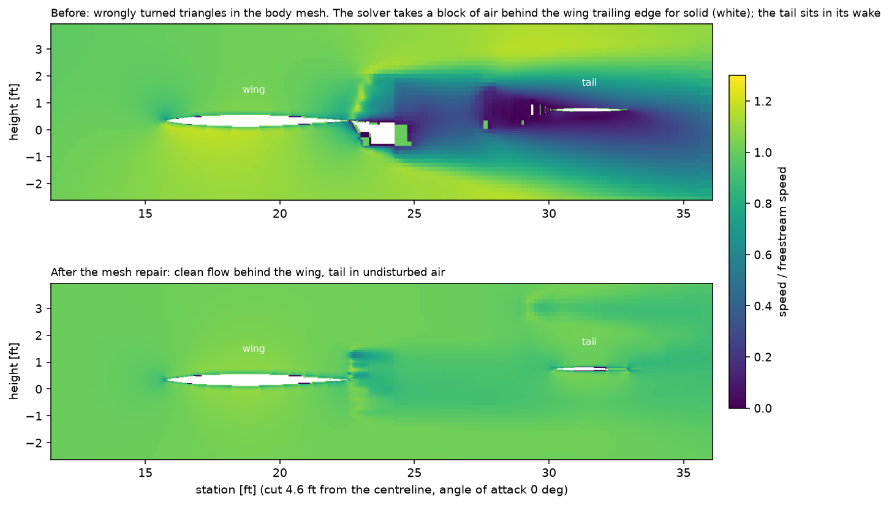

- The pitch law overshoots a 9 g command at height: 9.6 g at 15,000 ft, above 9 g for 1.4 s (9.0 g near sea level). It
  would need a command filter before it could be called a 9 g limiter. The roll-out of a hard turn unloads to near 0 g for a moment.
- Coefficient tables are those of one Mach number per run and do not change as the speed falls.
- No ground effect, no ground contact, no wind or turbulence. The run ends when the main wheels reach the runway.
- The flap is both flaperons 30 deg down; the notebook geometry has no moving surfaces, so the pictures show them neutral.
- Conventional tail only; the V-tail variant is not flown.
- The F-16C numbers come from a public-data reference model, good to roughly 10 %.

## Credit

The block-graph builder (`sim/model/graph.py`), the command schedules, the engine runner, the control-law structure
and the point-performance and F-16 reference code are ported from an earlier flight study by the same author.
