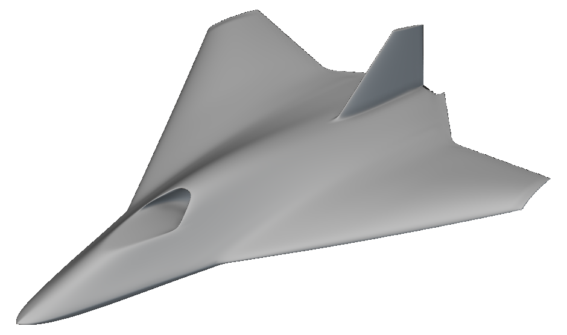

# nTop to CPACS: GBI aircraft round trip

Export measured GBI Rev38 aircraft sections to CPACS 3.5.1, change tip twist
from 2 to 4 degrees, and rebuild the native model through the Notebook API.
This revision includes the smooth wing/body twist transition and the completed
`demo-02` validation.

The CPACS bridge, twist repair, and report were built with GPT-6 through OpenAI
Codex. This attribution does not assign authorship of the earlier GBI source.



## Installation and use

1. Get the [complete connector repository](https://github.com/bradrothenberg/ntop-to-cpacs).
   The community button opens that repository so the scripts, schemas, native
   models, and measurements stay together.
2. To inspect the delivered model, download [ntop-to-cpacs.ntop](ntop-to-cpacs.ntop)
   and open a working copy in licensed nTop. The model has no external input files.
3. To inspect the report, download this package directory and open
   [reports/index.html](reports/index.html) with its assets beside it. Detailed
   evidence links point to the recorded source commit.
4. Follow the source README to run a fresh round trip. It requires Windows,
   licensed nTop Automate, and a build with the prototype Python Console Notebook API.

The published notebook is byte-identical to the final file reopened through the
Notebook API at 4 degrees with `e_OK`. It was authored with nTop 6.2.0-rc,
commit `f0d1327292729a0f88b4298abd1be4426564376f`. Geometry was also measured and
rendered with the installed nTop 6.2.2 engine. The manifest's `6.2.2` version does
not mean that the prototype Notebook API is available in that public release.

The source supports these commands from its repository root:

```powershell
uv sync --locked
uv run python scripts/verify_example.py
.\run_demo.ps1 -NTopExe "C:\path\to\Notebook API build\ntop.exe"
```

For the exact source revision used for this package, use
[commit e518a35](https://github.com/bradrothenberg/ntop-to-cpacs/tree/e518a3582ecda5dd20c58507d557681f050ae263).
The public repository includes all 103 hash-recorded example artifacts.

## Inputs and outputs

| Direction | Name or control | Meaning, unit, and limitation |
|---|---|---|
| Input | Native GBI Rev38 notebook | Retained source geometry and design controls |
| Input | `ntop:tipTwistDeg` | CPACS tool metadata mapped to native `Tip twist`, in degrees; only 2 and 4 are accepted |
| Output | Native aircraft | Final 4-degree model with a smooth added-twist transition |
| Output | CPACS XML | 20 wing/body sections and 11 fin sections in CPACS 3.5.1 |
| Output | Verification and report | API readback, schema checks, native contours, and repair evidence |

Other CPACS values and geometry edits are rejected. The XML request does not
update its measured geometry until nTop rebuilds and the exporter runs again.

## Files and reports

- [ntop-to-cpacs.ntop](ntop-to-cpacs.ntop): the final 4-degree notebook, with named
  sections and authored blocks collapsed.
- [reports/index.html](reports/index.html): the nTop report with blue accents,
  native before/after views, measured sections, and the twist-repair explanation.
- [publication-checks.json](publication-checks.json): source revision, native
  file identity, package hashes, and the publication audit scope.
- [Complete source and reproducible example](https://github.com/bradrothenberg/ntop-to-cpacs/tree/e518a3582ecda5dd20c58507d557681f050ae263): the runner, bridge,
  baseline notebook, CPACS files, schemas, and full measurement evidence.

The community folder contains the inspection model and report. Run the connector
from the complete source repository. The report uses local/system font fallbacks;
Google Fonts can supply Inter and IBM Plex Mono when a network is available.

## Evidence and limits

Both CPACS exports pass the official 3.5.1 schema with the typed nTop extension.
Independent decoding reproduces all 31 exported profiles within 8.95e-16 m.
This is a serialization check, not a surface-error measurement.

The twist repair keeps the 2-degree reference shape and spreads additional twist
through a C3 gate. All 31 remeasured baseline contour arrays match the previous
baseline bytes. Native field checks used 288 points per model. The repaired
candidate and final 4-degree recipes are identical. The source report preserves
the previous crease and measured comparison; this is not a global fairness claim.

CPACS omits the native inlet/exhaust passages, fin-root blend, and exact geometry
between sections. The native notebook retains these details. The 0.002 m slice
setting is not a certified error tolerance. TiGL loft compatibility and aerodynamic
performance remain unverified. The earlier full 20-section extraction exceeded its
120-second limit; the verified runner uses four-section batches.

Native results above were recorded during the source run. Publication checks
inspect the copied bytes and references; they do not claim a new native solve.
See [source verification](https://github.com/bradrothenberg/ntop-to-cpacs/blob/e518a3582ecda5dd20c58507d557681f050ae263/examples/gbi/verification.json) and
[repair evidence](https://github.com/bradrothenberg/ntop-to-cpacs/blob/e518a3582ecda5dd20c58507d557681f050ae263/examples/gbi/native-transition-verification.json).

## License and credits

The original connector code, authored example models, reports, and documentation
use the [MIT License](LICENSE), subject to the [license scope](license-scope.md).
This does not license nTop itself. nTop software, API/runtime implementations,
trademarks, logos, document style assets, fonts, and other third-party material
remain under their separate terms. Running the native workflow requires licensed
nTop software. The CPACS schema retains its Apache-2.0 license.

See [third-party notices](third-party-notices.md). Licensed Aeonik font files
are not included.
