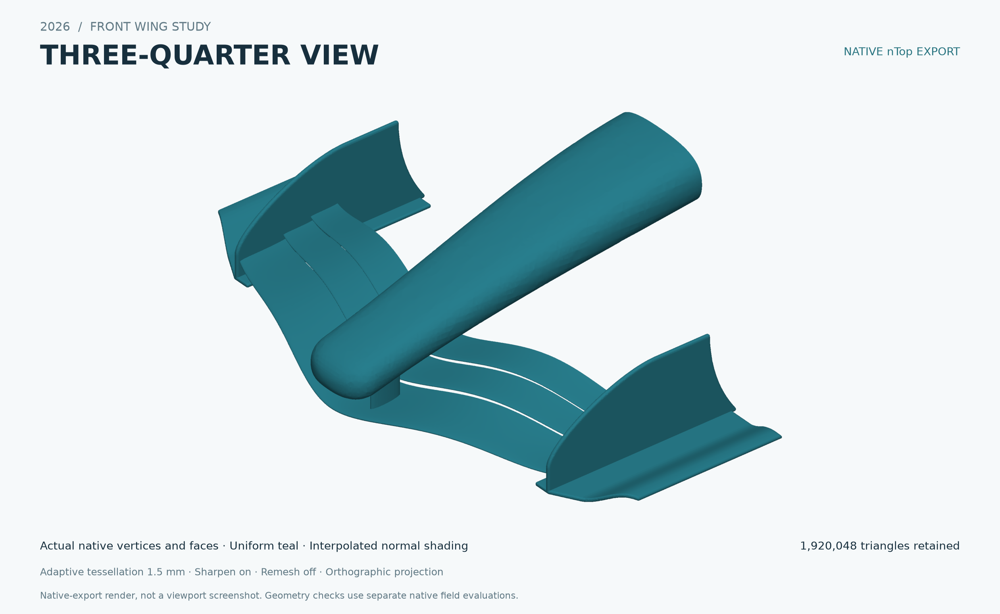

# Parametric 2026 front wing

A generic, editable, fixed three-element front-wing example with spanwise sweep and twist,
a conic nose, trimmed mounting pylons, swept endplates and curved footplates.
Twelve primary controls expose the design intent while retaining profiles, guide
rails, regulatory datums and intermediate geometry for inspection.

AI-assisted geometry and documentation: OpenAI Codex. The exact underlying model
variant was not recorded in the source package. The included CFD report is a
separate existing assessment; it is not a new analysis performed for publication.

## Download and use

1. Download [the complete bundle](f1-front-wing-2026.zip) and extract it.
2. Open `f1-front-wing-2026.ntop` in a licensed nTop installation. The study was
   built and checked with nTop 6.3.3 using its prototype Notebook API. No claim is
   made that the version number alone establishes compatibility with every public build.
3. Save a working copy. Edit the twelve INPUTS controls and rebuild.
4. Inspect the visible guards, element gaps, interfaces and geometry after edits.
   Individual input ranges do not guarantee every coupled configuration.
5. Read [the design report](design-report.pdf) and [the CFD report](cfd-report.pdf)
   before relying on the recorded results.

The nose-cap custom block is an embedded snapshot. No external CAD, profile,
spreadsheet or executable input dependency was found in this exact notebook.
It can be inspected within nTop; it does not update automatically from a separate
custom-block source. This compact archive does not include a standalone cap notebook.

## Inputs and output

| Main control | Default | Recorded study range | Effect and coupling |
|---|---|---|---|
| Root leading-edge height | 95 mm | 92 to 100 | Raises all three profiles and the pylon root. Coupled with tip rise and section camber. |
| Outboard rise | 40 mm | 38 to 43 | Smooth spanwise rise; zero derivative at the symmetry plane. |
| Slot lift | 40 mm | 39 to 41 | Element 2 height offset; element 3 is derived as 1.75 times this value. This is NOT the spherical slot gap. |
| Trailing-edge rise ratio | 0.12 dimensionless | 0.115 to 0.125 | Camber/incidence control: trailing height divided by each root chord. Both skins share the endpoint. |
| Rear element root chord | 120 mm | 118 to 125 | Changes third element chord; tip assembly chord remains 333 mm through derived taper. |
| Leading-edge sweep | 225 mm | 223 to 227 | Root-to-tip X displacement of the common leading datum. Cubic easing preserves centerline tangency. |
| Root trailing-edge radius | 0.7 mm | 0.65 to 0.8 | Native Fillet Curves radius before the two-rail sweep; section scaling changes the outboard radius. |
| Endplate thickness | 14 mm | 14 to 18 | Total lateral endplate thickness, including 6 mm rounded edge offset per side. Core thickness is derived as input minus 12 mm. |
| Pylon lateral station | 95 mm | 90 to 105 | Positive-side pylon center; negative side is mirrored. Front impact structure interface only. |
| Pylon chord | 100 mm | 90 to 110 | Streamlined pylon profile chord; lateral thickness is fixed at 24 mm maximum. |
| Spanwise shoulder height | 35 mm | 25 to 45 | Adds a smooth midspan elevation shoulder; zero at center and tip. |
| Tip section twist | -3 deg | -4 to 0 | Rotates complete sections progressively across span; negative lowers the trailing edge. |

Output: one symmetric fixed front-wing assembly as native nTop implicit geometry.
Nose details, section construction and regulatory constants remain named internal
controls. Their modification requires new validation beyond the exposed study ranges.

## Included files

- `f1-front-wing-2026.ntop`: final editable notebook.
- `design-report.pdf`: 12-page illustrated geometry and validation report.
- `cfd-report.pdf`: 8-page existing CFD assessment.
- `cover.png`: actual model-derived native-export render, not a viewport screenshot.
- `publication-audit.json`: compact source/published hashes and audit scope.

The ZIP contains the notebook, both PDF reports, cover, README, manifest, audit
and MIT license. The CFD content is limited to its results PDF: the interactive
viewer, source mesh, numerical fields and raw solver files are intentionally
omitted. Detailed historical JSON evidence, the official regulations PDF, the
design HTML report and historical revisions are also not included.

References to omitted files in the reports identify the original study record.
Nonportable local file links and an unverified shared-viewer link were removed
from the public PDFs; visible technical content and official FIA HTTPS citations
are preserved.

## Evidence and limits

The notebook bytes match the previously validated distribution copy. Recorded
checks include 1,714 native surface/sign witnesses across default and selected
parameter variations, 38 analytical parameter cases, and a later annotation-only
packaging check with 18 native witnesses and seven default guards. These are
historical results; publication performs file, dependency and content audits,
not another native geometry or solver run.

The regulatory baseline is FIA 2026 Section C Issue 21, dated 19 October 2026.
It is the baseline of this archived study, not a claim that it remains the newest
edition on the publication date. Full FIA conformity is provisional. Continuous
gap/junction constraints, complete-vehicle context, structural deflection and
crash/homologation requirements are not established. No active-aero mechanism is fitted.

The visualization mesh used for the cover had five nonmanifold edges and three
degenerate triangles. It was not a certified watertight manufacturing/CFD mesh.

The CFD report concerns a separately supplied mesh. Exact equivalence to the
delivered notebook was not established. Its steady RANS run stopped at an iteration
cap rather than satisfying residual targets; force variation and coarse-mesh
limitations are retained in the report. It does not establish optimized or verified
performance for this notebook.

## License and credits

Contributor: **Guenael Morvan** (@guenaelmorvan).
The notebook, embedded nose-cap block and both reports are shared under the
[MIT license](LICENSE), as authorized by the contributor.
FIA documents are cited as the study's regulatory authority; no FIA document is
redistributed. This is a generic educational design example. No team affiliation,
endorsement, aerodynamic optimization or regulatory certification is implied.
