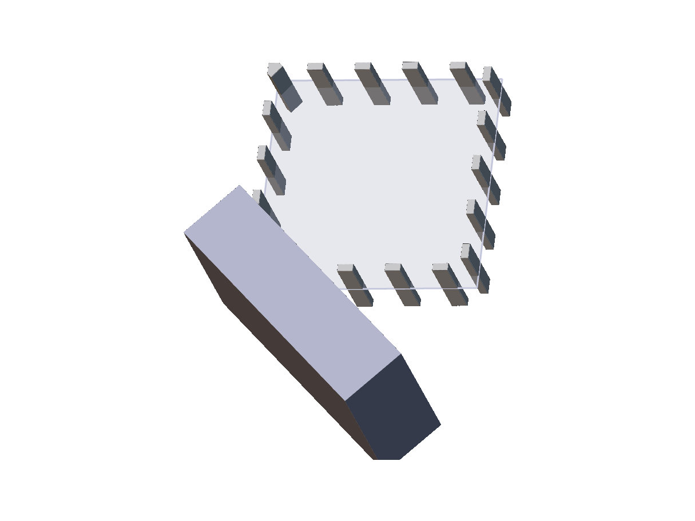

# Add Finger Joints

Creates finger joints along a profile edge. Evenly spaced fingers are placed along the profile curve (trimmed against the area to avoid), turned into a finger profile and extruded to form a solid body.

## Install

1. Download `Add Finger Joints.ntop`.
2. In nTop, import it from the Custom Blocks panel (or open the file to see how the block is built).
   The block appears as **Add Finger Joints**.

Last saved in nTop 6.3.3; checked to open in nTop 6.4.3.

## Usage

Add the block to a notebook, wire the inputs below, and use its output downstream.

## Inputs

| Input | Type | Description |
|---|---|---|
| Profile | profile | Profile whose edge receives the finger joints. |
| Area to Avoid | implicit body | Body used to trim the profile curve before fingers are placed. |
| To Remain | inside / outside | Whether the part of the curve inside or outside the Area to Avoid is kept. |
| Curve refinement | number | Refinement length used when trimming the curve against the Area to Avoid. |
| Gap | number | Gap between neighbouring fingers. |
| Finger Length | number | Length of each finger along the curve. |
| extrusion distance | number | Distance the finger profile is extruded to form the joint body. |

## Output

| Output | Type |
|---|---|
| Add Finger Joints | implicit body |

## License

MIT License, copyright nTop; see `LICENSE`. Block descriptions were tidied with AI assistance (Claude).
