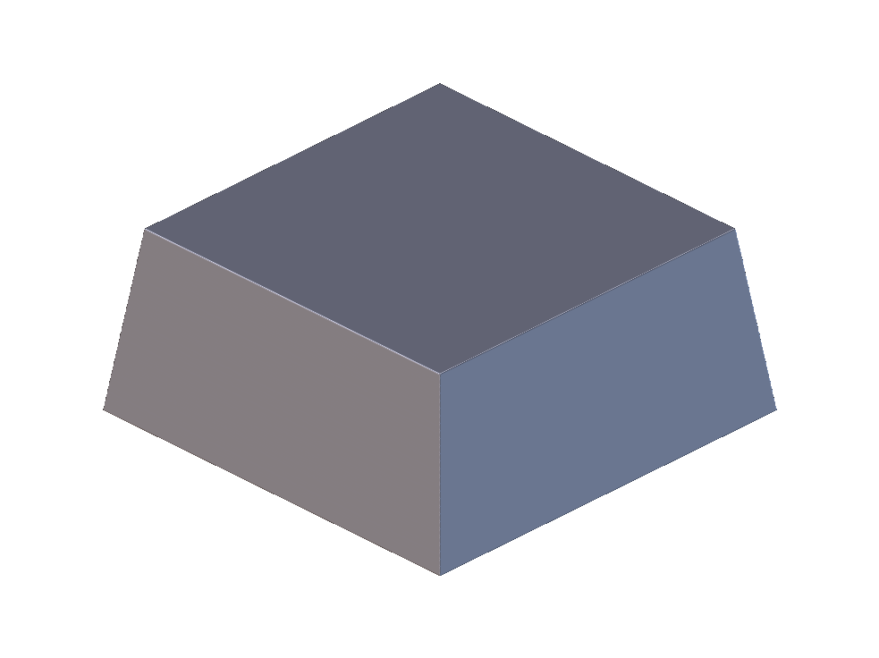

# Add Implicit Draft

Adds implicit draft and performs a distance field correction. Note that material will be added or removed everywhere, so it's best to trim to the final height after this step rather than before.

_Cover: the block run on simple example inputs (spheres, boxes, curves) set up for the picture; that example notebook is not included._

## Install

1. Download `Add Implicit Draft.ntop`.
2. In nTop, import it from the Custom Blocks panel (or open the file to see how the block is built).
   The block appears as **Add Implicit Draft**.

Last saved in nTop 5.22.0; checked to open in nTop 6.4.3.

## Usage

Add the block to a notebook, wire the inputs below, and use its output downstream.

## Inputs

| Input | Type | Description |
|---|---|---|
| Body | implicit body | Implicit body that the draft is applied to. |
| Parting Surface | implicit body | Parting surface that the draft distance is measured from. |
| Draft Angle | scalar field | Draft angle applied to the body walls. |

## Output

| Output | Type |
|---|---|
| Add Implicit Draft | implicit body |

## License

MIT License, copyright nTop; see `LICENSE`. Block descriptions were tidied with AI assistance (Claude).
