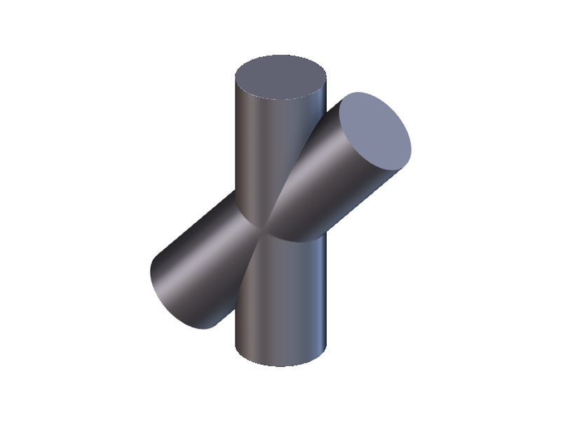

# Align Implicit Body to Global Axes

This block rotates an implicit body so that it's principal Z axis lines up with the global Z axis and so its principal X/Y axes line up with the global X/Y axes.

_Cover: the block run on simple example inputs (spheres, boxes, curves) set up for the picture; that example notebook is not included._

## Install

1. Download `Align Implicit Body to Global Axes.ntop`.
2. In nTop, import it from the Custom Blocks panel (or open the file to see how the block is built).
   The block appears as **Align Implicit Body to Global Axes**.

Last saved in nTop 5.0.4; checked to open in nTop 6.4.3.

## Usage

Add the block to a notebook, wire the inputs below, and use its output downstream.

## Inputs

| Input | Type | Description |
|---|---|---|
| Body | implicit body | Body to Rotate |
| Flip Z Direction | toggle | Flips Z direction by 180 degrees |
| Swap X and Y Direction | toggle | Swaps the X and Y directions |
| Flip X/Y Direction | toggle | Flips the X/Y direction by 180 degrees |

## Output

| Output | Type |
|---|---|
| Align Implicit Body to Global Axes | implicit body |

## License

MIT License, copyright nTop; see `LICENSE`. Block descriptions were tidied with AI assistance (Claude).
