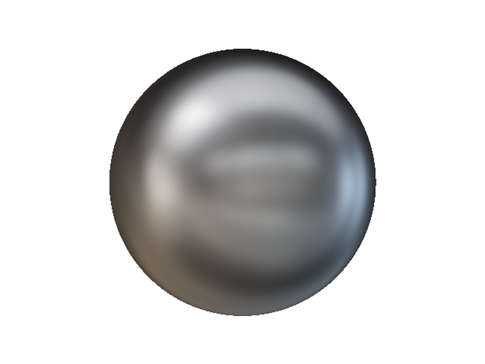

# Angled Supports from Surface Points

Finds the shortest angled support line from a surface point. Rays are cast from the point at the support angle to the build direction, spaced evenly around it by the rotation count, and the shortest resulting line segment is returned.

## Install

1. Download `Angled Supports from Surface Points.ntop`.
2. In nTop, import it from the Custom Blocks panel (or open the file to see how the block is built).
   The block appears as **Angled Supports from Surface Points**.

Last saved in nTop 5.50.2; checked to open in nTop 6.4.3.

## Usage

Add the block to a notebook, wire the inputs below, and use its output downstream.

## Inputs

| Input | Type | Description |
|---|---|---|
| Point | point | Surface point where the support starts. |
| Support Angle | number | Angle between each support direction and the negative build direction. |
| Build Direction | vector | Build (printing) direction of the part. |
| Rotation Count | integer | Number of directions, evenly spaced around the build direction, that are tried. |
| Body | implicit body | Body that the rays are cast against to find where each support line ends. |

## Output

| Output | Type |
|---|---|
| Angled Supports from Surface Points | line segment |

## License

MIT License, copyright nTop; see `LICENSE`. Block descriptions were tidied with AI assistance (Claude).
