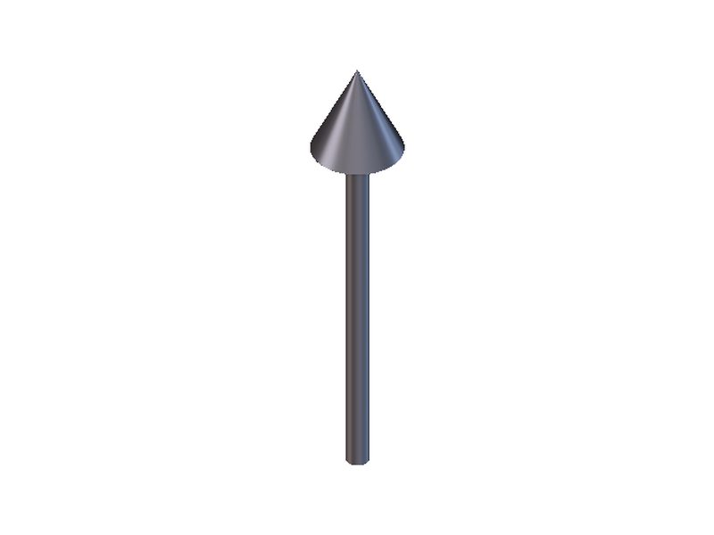

# Arrow from Line Segment

Creates an arrow body from an origin, a direction and a length. The shaft is a cylinder and the head is a cone, combined with a union.

## Install

1. Download `Arrow from Line Segment.ntop`.
2. In nTop, import it from the Custom Blocks panel (or open the file to see how the block is built).
   The block appears as **Arrow from Line Segment**.

Last saved in nTop 6.3.3; checked to open in nTop 6.4.3.

## Usage

Add the block to a notebook, wire the inputs below, and use its output downstream.

## Inputs

| Input | Type | Description |
|---|---|---|
| Origin | point | Start point of the arrow. |
| Direction | vector | Direction the arrow points. Use a unit vector so Length is the true arrow length. |
| Length | number | Overall length of the arrow measured along Direction. |

## Output

| Output | Type |
|---|---|
| Arrow from Line Segment | implicit body |

## License

MIT License, copyright nTop; see `LICENSE`. Block descriptions were tidied with AI assistance (Claude).
