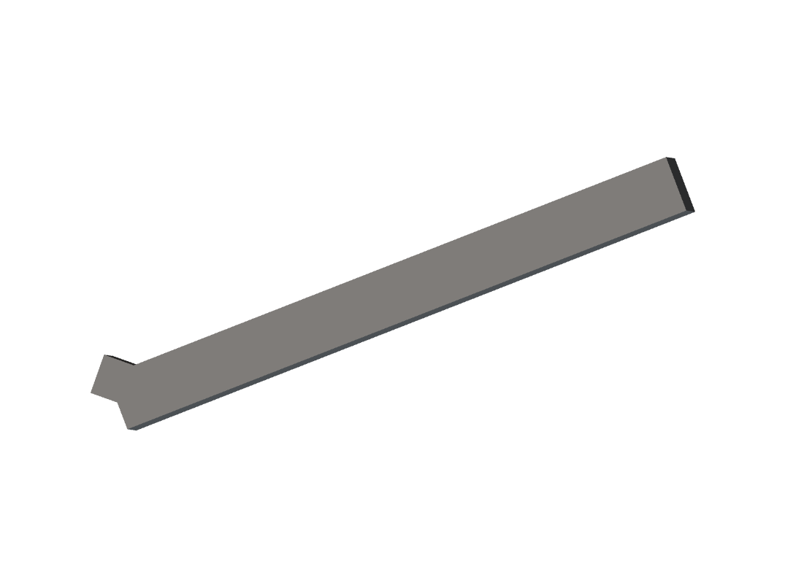

# Box from Graph

This custom block creates a box that determines its height based on two points. Acts very similar to the cylinder block.

## Install

1. Download `Box from Graph.ntop`.
2. In nTop, import it from the Custom Blocks panel (or open the file to see how the block is built).
   The block appears as **Box from Graph**.

Last saved in nTop 5.27.2; checked to open in nTop 6.4.3.

## Usage

Add the block to a notebook, wire the inputs below, and use its output downstream.

## Inputs

| Input | Type | Description |
|---|---|---|
| Graph | graph | Lattice (graph) whose beams each receive a box. |
| Length | number | Length of the box cross-section. |
| Width | number | Width of the box cross-section. |
| Angle | number | Angle each box is rotated about its beam axis. |

## Output

| Output | Type |
|---|---|
| Box from Graph | list of box |

## License

MIT License, copyright nTop; see `LICENSE`. Block descriptions were tidied with AI assistance (Claude).
