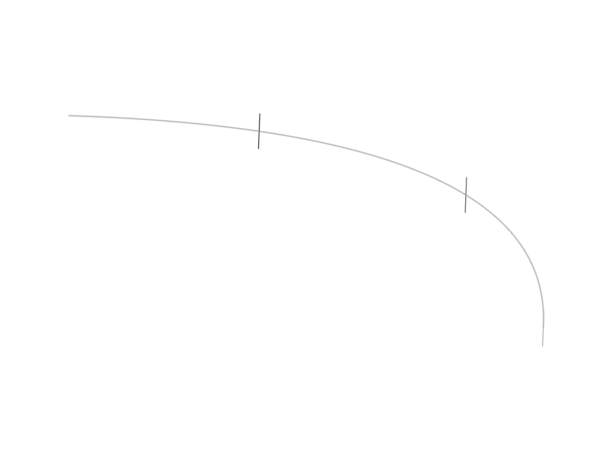

# Centered Equidistant Beams on Curve

Creates a lattice of beams at equal spacing along a curve. The beams are centered on the curve and extend in both directions.

## Install

1. Download `Centered Equidistant Beams on Curve.ntop`.
2. In nTop, import it from the Custom Blocks panel (or open the file to see how the block is built).
   The block appears as **Centered Equidistant Beams on Curve**.

Last saved in nTop 5.53.2; checked to open in nTop 6.4.3.

## Usage

Add the block to a notebook, wire the inputs below, and use its output downstream.

## Inputs

| Input | Type | Description |
|---|---|---|
| Curve | curve | Curve along which the beams are placed. |
| Direction | scalar field | Scalar field whose gradient sets the direction of each beam. |
| Length | scalar field | Scalar field giving the length of each beam. |
| Increment | number | Spacing between beam locations along the curve. |

## Output

| Output | Type |
|---|---|
| Centered Equidistant Beams on Curve | graph |

## License

MIT License, copyright nTop; see `LICENSE`. Block descriptions were tidied with AI assistance (Claude).
