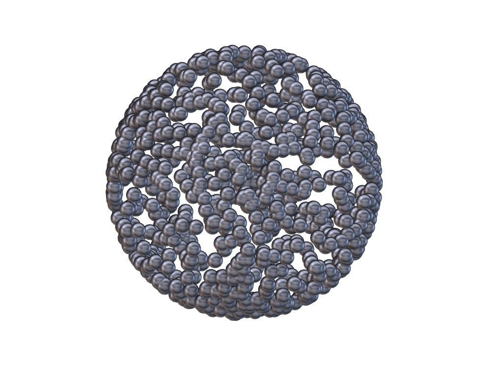

# Closest Point to Body (No Tolerance)

This block translates points to the closest point on a body by translating a point by the magnitude of its distance field multiplied by the negative unit vector of it's gradient

_Cover: the block run on simple example inputs (spheres, boxes, curves) set up for the picture; that example notebook is not included._

## Install

1. Download `Closest Point to Body (No Tolerance).ntop`.
2. In nTop, import it from the Custom Blocks panel (or open the file to see how the block is built).
   The block appears as **Closest Point to Body (No Tolerance)**.

Last saved in nTop 4.25.2; checked to open in nTop 6.4.3.

## Usage

Add the block to a notebook, wire the inputs below, and use its output downstream.

## Inputs

| Input | Type | Description |
|---|---|---|
| Body | implicit body | Implicit Body on which to find the closest points |
| Points | list of point | Points to project onto the body |

## Output

| Output | Type |
|---|---|
| Closest Point to Body (No Tolerance) | list of point |

## License

MIT License, copyright nTop; see `LICENSE`. Block descriptions were tidied with AI assistance (Claude).
