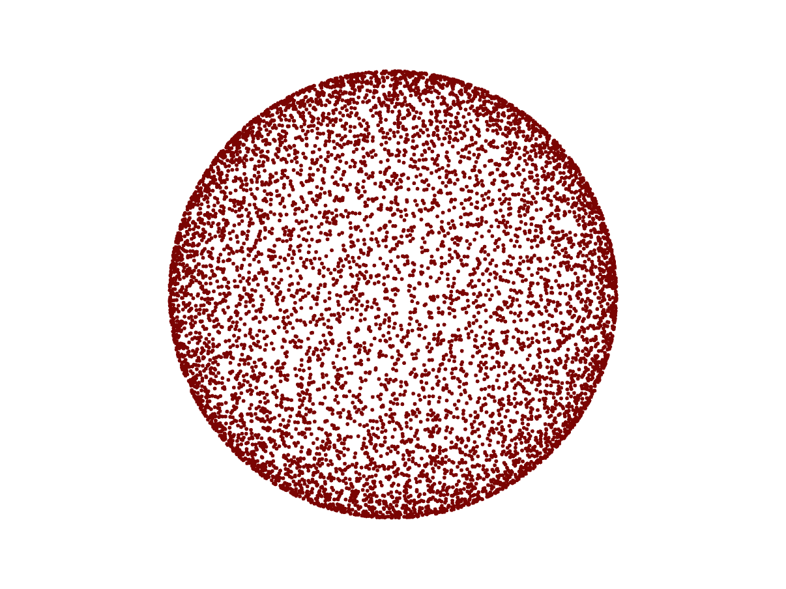

# Color Point Map on Body

This custom block creates a point map in one color on the part of the body.

_Cover: the block run on simple example inputs (spheres, boxes, curves) set up for the picture; that example notebook is not included._

## Install

1. Download `Color Point Map on Body.ntop`.
2. In nTop, import it from the Custom Blocks panel (or open the file to see how the block is built).
   The block appears as **Color Point Map on Body**.

Last saved in nTop 3.44.4; checked to open in nTop 6.4.3.

## Usage

Add the block to a notebook, wire the inputs below, and use its output downstream.

## Inputs

| Input | Type | Description |
|---|---|---|
| Geometry | implicit body | Body that the point map is created on. |
| Point Spacing | number | Approximate spacing between the sample points in the body. |
| Color | number | Color: 0 - Dark Purple/Blue, 1 - Red |

## Output

| Output | Type |
|---|---|
| Color Point Map on Body | real_point_map |

## License

MIT License, copyright nTop; see `LICENSE`. Block descriptions were tidied with AI assistance (Claude).
