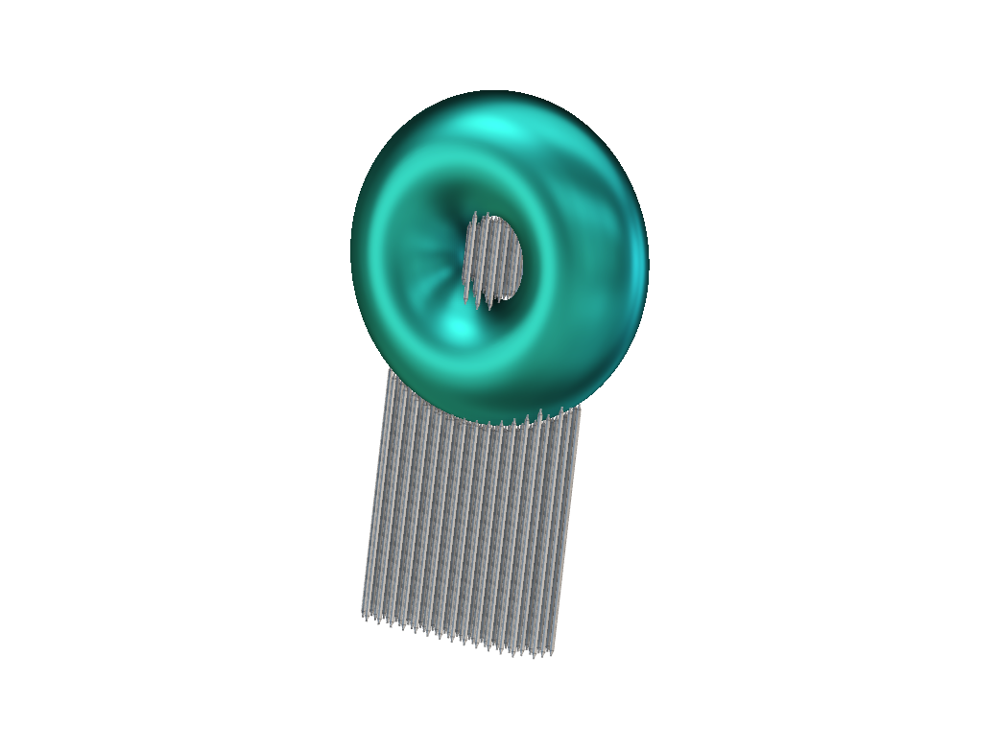

# Cross Bar Support

This custom block produces cross bar mesh supports at areas of overhang of a given part.

## Install

1. Download `Cross Bar Support.ntop`.
2. In nTop, import it from the Custom Blocks panel (or open the file to see how the block is built).
   The block appears as **Cross Bar Support**.

Last saved in nTop 5.26.2; checked to open in nTop 6.4.3.

## Usage

Add the block to a notebook, wire the inputs below, and use its output downstream.

## Inputs

| Input | Type | Description |
|---|---|---|
| Part | implicit body | The part to generate supports form. |
| Point spacing | number | The density of connection points on the part. This also drives the descritization density. |
| Teeth Length | number | length of the teeth generated |
| Bar Width | number | Thickness of the teeth and the bar |
| Overhang angle | number | Overhang angle to determine where supports are applied to the part. |
| Build plane | plane | Plane that defines the build plate and the build direction. |

## Output

| Output | Type |
|---|---|
| Cross Bar Support | mesh |

## License

MIT License, copyright nTop; see `LICENSE`. Block descriptions were tidied with AI assistance (Claude).
