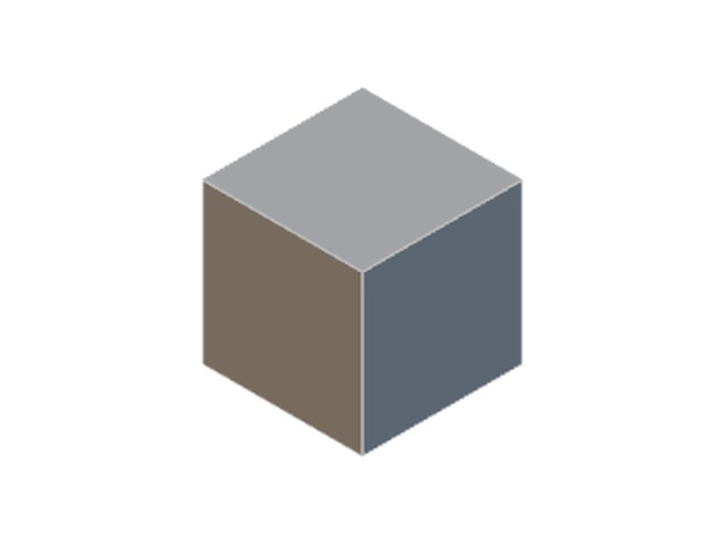

# Cube Bounding Box

Creates a bounding box in the shape of a cube from a center point and a size.

## Install

1. Download `Cube Bounding Box.ntop`.
2. In nTop, import it from the Custom Blocks panel (or open the file to see how the block is built).
   The block appears as **Cube Bounding Box**.

Last saved in nTop 5.31.3; checked to open in nTop 6.4.3.

## Usage

Add the block to a notebook, wire the inputs below, and use its output downstream.

## Inputs

| Input | Type | Description |
|---|---|---|
| Center Point | point | Center of the cube. |
| Size | number | Edge length of the cube. |

## Output

| Output | Type |
|---|---|
| Cube Bounding Box | bounding_box |

## License

MIT License, copyright nTop; see `LICENSE`. Block descriptions were tidied with AI assistance (Claude).
