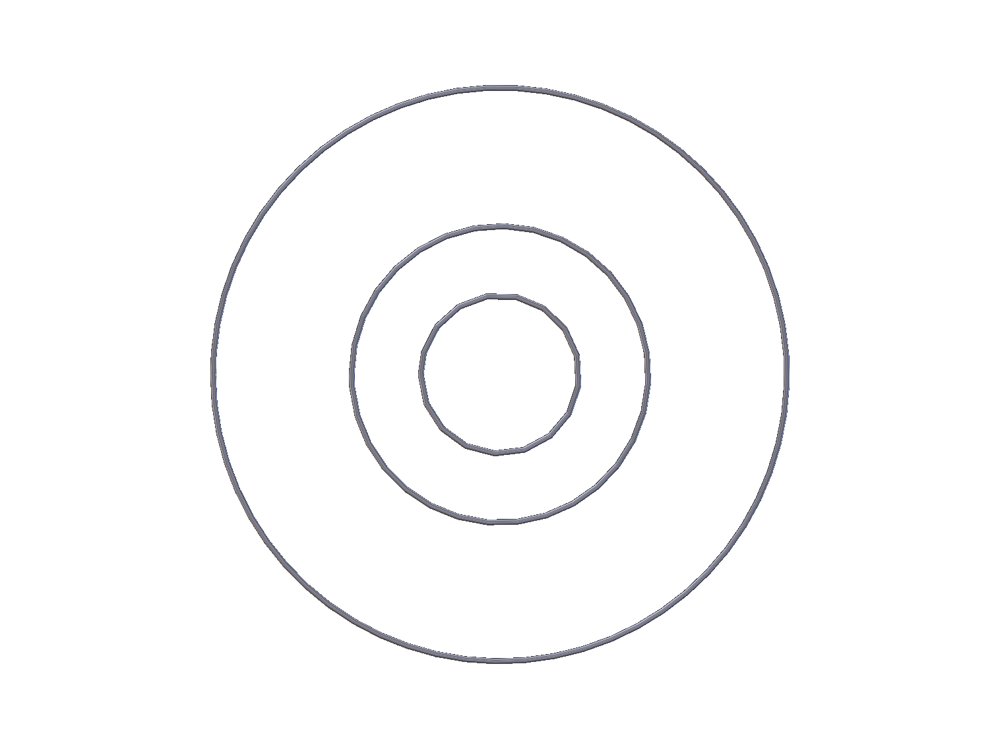

# Graph from Slices

Creates a lattice (graph) from the closed and open curves of a slice, with points spaced by the increment along each curve.

_Cover: the block run on simple example inputs (spheres, boxes, curves) set up for the picture; that example notebook is not included._

## Install

1. Download `Graph from Slices.ntop`.
2. In nTop, import it from the Custom Blocks panel (or open the file to see how the block is built).
   The block appears as **Graph from Slices**.

Last saved in nTop 4.2.3; checked to open in nTop 6.4.3.

## Usage

Add the block to a notebook, wire the inputs below, and use its output downstream.

## Inputs

| Input | Type | Description |
|---|---|---|
| Slice_0 | slice | Slice whose curves are converted into a graph. |
| Increment | number | Spacing between points along the slice curves. |

## Output

| Output | Type |
|---|---|
| Graph from Slices | graph |

## License

MIT License, copyright nTop; see `LICENSE`. Block descriptions were tidied with AI assistance (Claude).
