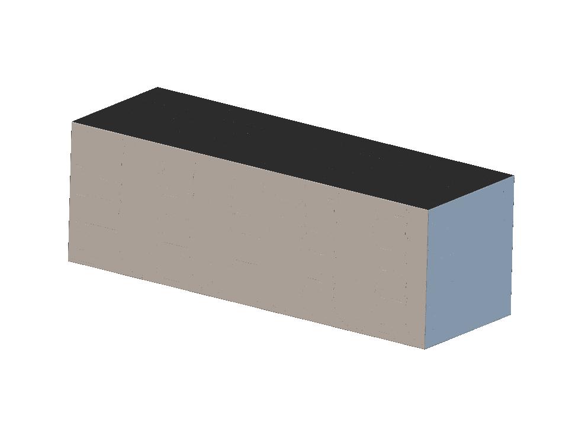

# Lattice by Relative Density

Creates a beam lattice which is defined by the Unit Cell, Unit Cell Size, and a Relative Density value. These are used to calculate the beam thickness needed to achieve the correct relative density defined by the user.

## Install

1. Download `Lattice by Relative Density.ntop`.
2. In nTop, import it from the Custom Blocks panel (or open the file to see how the block is built).
   The block appears as **Lattice by Relative Density**.

Last saved in nTop 5.44.2; checked to open in nTop 6.4.3.

## Usage

Add the block to a notebook, wire the inputs below, and use its output downstream.

## Inputs

| Input | Type | Description |
|---|---|---|
| Lattice Unit Cell | unit cell | Lattice Type |
| Scale | vector | Lattice Unit Cell Size |
| Relative Density | number | Relative Density (0 -1) |

## Output

| Output | Type |
|---|---|
| Lattice by Relative Density | number |

## License

MIT License, copyright nTop; see `LICENSE`. Block descriptions were tidied with AI assistance (Claude).
