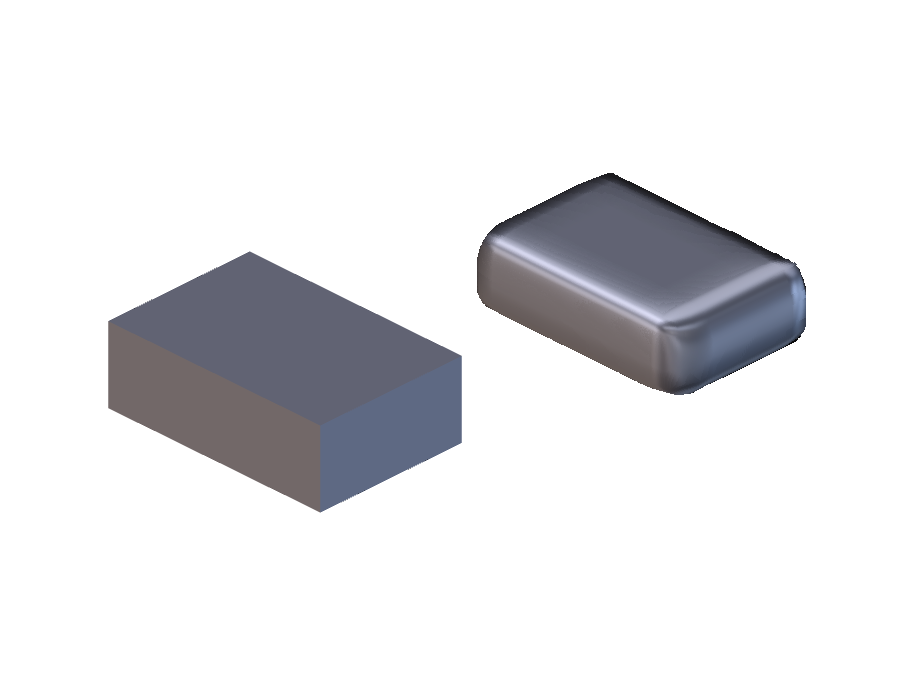

# Move Along Plane

This custom block will take an implicit body and move it based on a new coordinate system. IF the UVW Translation is <0,0,0>, the body will be centered on the origin of the starting plane.

_Cover: the block run on simple example inputs (spheres, boxes, curves) set up for the picture; that example notebook is not included._

## Install

1. Download `Move Along Plane.ntop`.
2. In nTop, import it from the Custom Blocks panel (or open the file to see how the block is built).
   The block appears as **Move Along Plane**.

Last saved in nTop 3.26.3; checked to open in nTop 6.4.3.

## Usage

Add the block to a notebook, wire the inputs below, and use its output downstream.

## Inputs

| Input | Type | Description |
|---|---|---|
| Body | implicit body | Body to move |
| UVW Translation | vector | Using the UVW coordinate system to translate where the W is normal to the face. |

## Output

| Output | Type |
|---|---|
| Move Along Plane | scalar field |

## License

MIT License, copyright nTop; see `LICENSE`. Block descriptions were tidied with AI assistance (Claude).
