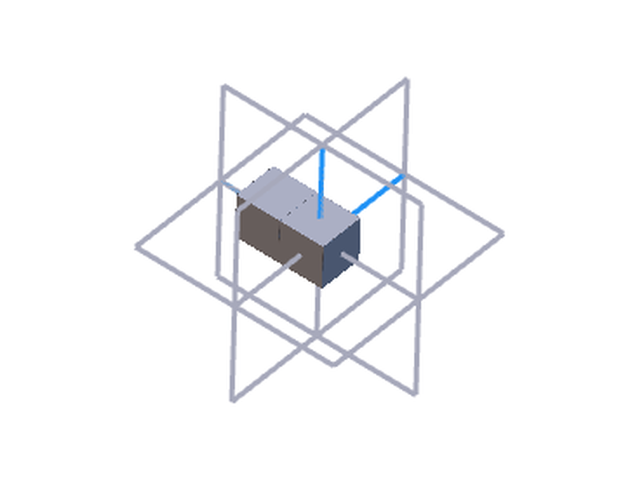

# Move Along the UVW

This custom block will take an implicit body and move it based on a new coordinate system.

## Install

1. Download `CB Move Along the UVW.ntop`.
2. In nTop, import it from the Custom Blocks panel (or open the file to see how the block is built).
   The block appears as **CB Move Along the UVW**.

Last saved in nTop 3.25.3; checked to open in nTop 6.4.3.

## Usage

Add the block to a notebook, wire the inputs below, and use its output downstream.

## Inputs

| Input | Type | Description |
|---|---|---|
| Implicit | implicit body | Recommended to start with this at the (0,0,0). |
| Origin | point | Origin point of the UVW coordinate system. |
| Starting U Direction | vector | (Given this direction, it will take find the perpendicular direction for the V direction and then take the cross product of those two vectors to get the W direction) |
| UVW Translation | vector | Using the UVW coordinate system to Tranlsate |

## Output

| Output | Type |
|---|---|
| CB Move Along the UVW | scalar field |

## License

MIT License, copyright nTop; see `LICENSE`. Block descriptions were tidied with AI assistance (Claude).
