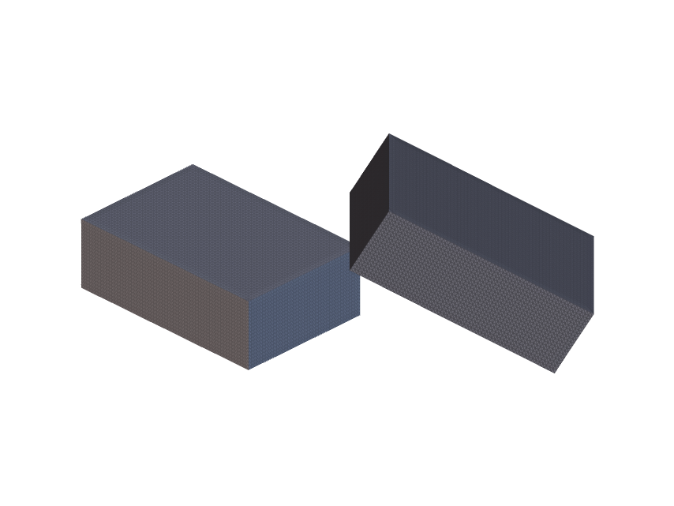

# Move Mesh

This block moves the Mesh's center to the new location provided and rotates the object if you choose.

_Cover: the block run on simple example inputs (spheres, boxes, curves) set up for the picture; that example notebook is not included._

## Install

1. Download `CB Move Mesh.ntop`.
2. In nTop, import it from the Custom Blocks panel (or open the file to see how the block is built).
   The block appears as **CB Move Mesh**.

Last saved in nTop 3.24.3; checked to open in nTop 6.4.3.

## Usage

Add the block to a notebook, wire the inputs below, and use its output downstream.

## Inputs

| Input | Type | Description |
|---|---|---|
| Object | mesh | Mesh to move and rotate. |
| New Location | point | Location the center of the mesh is moved to. |
| X Rotation Angle | number | Rotation Angle around the X axis |
| Y Rotation Angle | number | Rotation Angle around the Y axis |
| Z Rotation Angle | number | Rotation Angle around the Z axis |

## Output

| Output | Type |
|---|---|
| CB Move Mesh | spatial3d |

## License

MIT License, copyright nTop; see `LICENSE`. Block descriptions were tidied with AI assistance (Claude).
