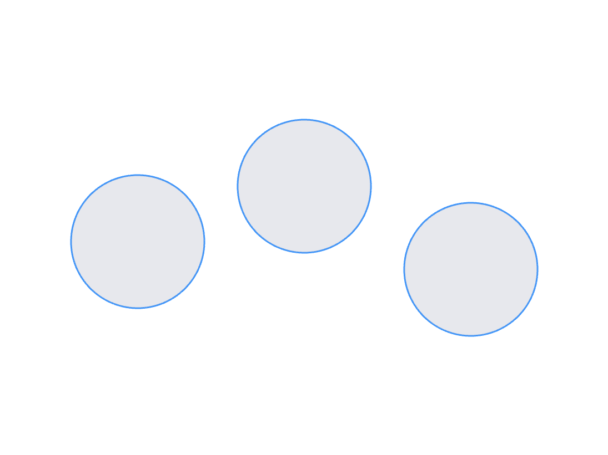

# Multiple Profiles from Curve List

Creates a profile from each curve in a list.

_Cover: the block run on simple example inputs (spheres, boxes, curves) set up for the picture; that example notebook is not included._

## Install

1. Download `Multiple Profiles from Curve List.ntop`.
2. In nTop, import it from the Custom Blocks panel (or open the file to see how the block is built).
   The block appears as **Multiple Profiles from Curve List**.

Last saved in nTop 5.44.2; checked to open in nTop 6.4.3.

## Usage

Add the block to a notebook, wire the inputs below, and use its output downstream.

## Inputs

| Input | Type | Description |
|---|---|---|
| Curve List | list of curve | Curves to convert into profiles. |
| Normal | vector | Normal direction of the plane the profiles are created in. |

## Output

| Output | Type |
|---|---|
| Multiple Profiles from Curve List | list of profile |

## License

MIT License, copyright nTop; see `LICENSE`. Block descriptions were tidied with AI assistance (Claude).
