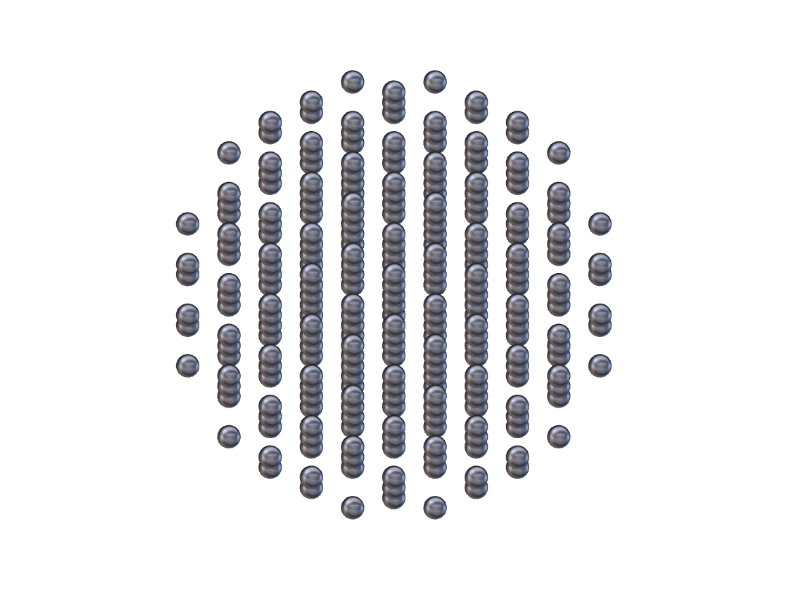

# Ordered Points in a Body

This custom block generates an ordered list of points within in an implicit body following a rectangular cell map.

_Cover: the block run on simple example inputs (spheres, boxes, curves) set up for the picture; that example notebook is not included._

## Install

1. Download `Ordered Points in a Body.ntop`.
2. In nTop, import it from the Custom Blocks panel (or open the file to see how the block is built).
   The block appears as **Ordered Points in a Body**.

Last saved in nTop 5.4.2; checked to open in nTop 6.4.3.

## Usage

Add the block to a notebook, wire the inputs below, and use its output downstream.

## Inputs

| Input | Type | Description |
|---|---|---|
| Volume | implicit body | Implicit body to generate ordered points within |
| Point Spacing | vector | Spacing distance in the x, y and z direction for points. |
| Frame | frame | Frame of reference for point generation. |

## Output

| Output | Type |
|---|---|
| Ordered Points in a Body | list of point |

## License

MIT License, copyright nTop; see `LICENSE`. Block descriptions were tidied with AI assistance (Claude).
