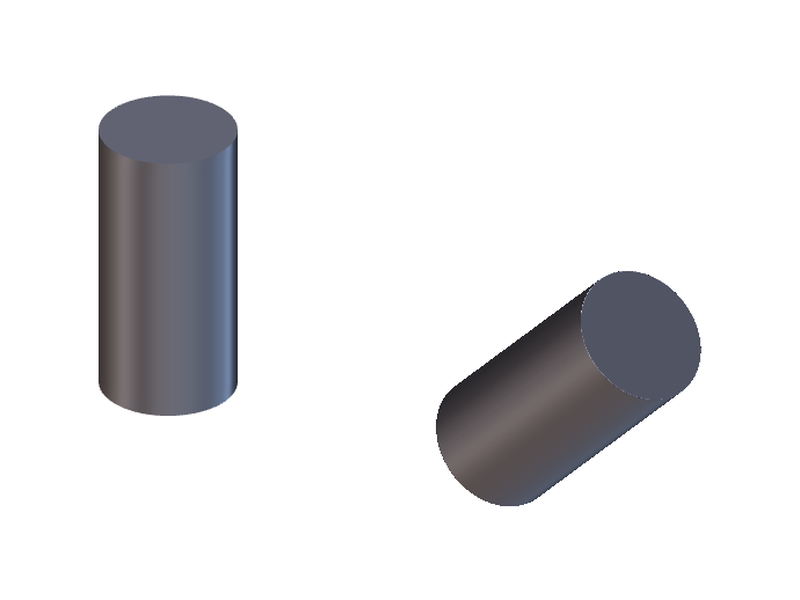

# Orient Implicit

Orients an implicit body to a destination plane by remapping its coordinates onto the frame of that plane.

_Cover: the block run on simple example inputs (spheres, boxes, curves) set up for the picture; that example notebook is not included._

## Install

1. Download `Orient Implicit.ntop`.
2. In nTop, import it from the Custom Blocks panel (or open the file to see how the block is built).
   The block appears as **Orient Implicit**.

Last saved in nTop 5.15.2; checked to open in nTop 6.4.3.

## Usage

Add the block to a notebook, wire the inputs below, and use its output downstream.

## Inputs

| Input | Type | Description |
|---|---|---|
| Scalar Field | implicit body | Implicit body to orient. |
| Destination | plane | Plane whose frame the body is oriented to. |

## Output

| Output | Type |
|---|---|
| Orient Implicit | implicit body |

## License

MIT License, copyright nTop; see `LICENSE`. Block descriptions were tidied with AI assistance (Claude).
