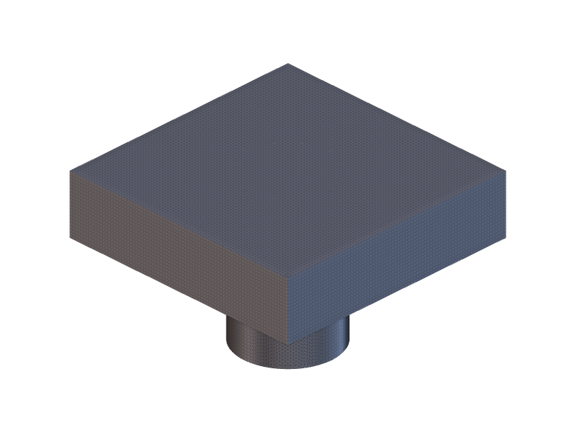

# Orient Mesh to Independent Mesh

This custom block takes in an independent mesh and a dependent mesh and will orient the dependent mesh at the independent point.

_Cover: the block run on simple example inputs (spheres, boxes, curves) set up for the picture; that example notebook is not included._

## Install

1. Download `Orient Mesh to Independent Mesh.ntop`.
2. In nTop, import it from the Custom Blocks panel (or open the file to see how the block is built).
   The block appears as **Orient Mesh to Independent Mesh**.

Last saved in nTop 4.15.3; checked to open in nTop 6.4.3.

## Usage

Add the block to a notebook, wire the inputs below, and use its output downstream.

## Inputs

| Input | Type | Description |
|---|---|---|
| Independent mesh | mesh | Will remain in the same position. |
| Independent point | point | Location where the the dependent mesh will be placed |
| Dependent mesh | mesh | Will move to the new location. In the output, this oriented mesh will be the second item in the list. |
| Dependent point | point | Location where the dependent mesh will connect with the independent mesh. |
| Flip | toggle | Flips the orientation of the dependent mesh at the independent point. |

## Output

| Output | Type |
|---|---|
| Orient Mesh to Independent Mesh | list of mesh |

## License

MIT License, copyright nTop; see `LICENSE`. Block descriptions were tidied with AI assistance (Claude).
