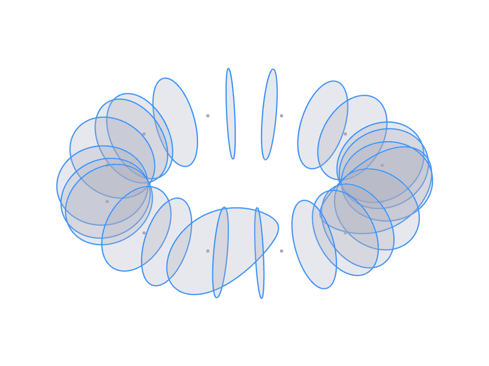

# Sections along Curve

Extracts profiles from a body at evenly spaced planes along a curve.

_Cover: the block run on simple example inputs (spheres, boxes, curves) set up for the picture; that example notebook is not included._

## Install

1. Download `sections_along_curve.ntop`.
2. In nTop, import it from the Custom Blocks panel (or open the file to see how the block is built).
   The block appears as **Sections along Curve**.

Last saved in nTop 5.24.3; checked to open in nTop 6.4.3.

## Usage

Add the block to a notebook, wire the inputs below, and use its output downstream.

## Inputs

| Input | Type | Description |
|---|---|---|
| Body | implicit body | Body to take the sections from. |
| Curve | curve | Curve that the section planes follow. |
| Sections | integer | Number of sections taken along the curve. |
| Min. Feature Size | number | Smallest feature size to resolve when extracting each section. |

## Output

| Output | Type |
|---|---|
| Sections along Curve | list of profile |

## License

MIT License, copyright nTop; see `LICENSE`. Block descriptions were tidied with AI assistance (Claude).
