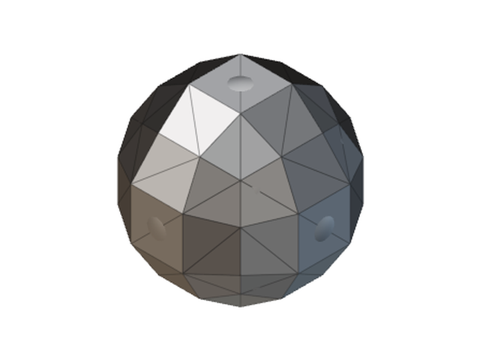

# Surface Area of Each Flat Face

Calculates the surface area of each flat face of a mesh.

## Install

1. Download `Surface Area of Each Flat Face.ntop`.
2. In nTop, import it from the Custom Blocks panel (or open the file to see how the block is built).
   The block appears as **Surface area of each flat face**.

Last saved in nTop 5.43.2; checked to open in nTop 6.4.3.

## Usage

Add the block to a notebook, wire the inputs below, and use its output downstream.

## Inputs

| Input | Type | Description |
|---|---|---|
| Mesh | mesh | Mesh whose flat faces are measured. |

## Output

| Output | Type |
|---|---|
| Surface area of each flat face | list of number |

## License

MIT License, copyright nTop; see `LICENSE`. Block descriptions were tidied with AI assistance (Claude).
