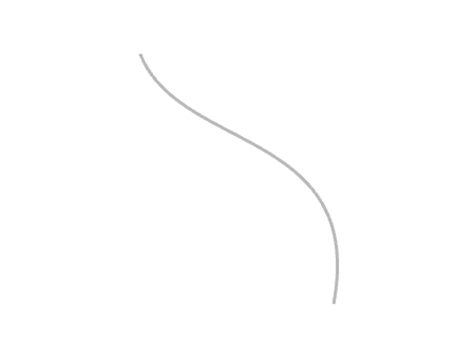

# Trim Curve with Body

This custom block trims a curve with a body either inside or ouside the body

## Install

1. Download `Trim Curve with Body.ntop`.
2. In nTop, import it from the Custom Blocks panel (or open the file to see how the block is built).
   The block appears as **Trim Curve with Body**.

Last saved in nTop 5.39.2; checked to open in nTop 6.4.3.

## Usage

Add the block to a notebook, wire the inputs below, and use its output downstream.

## Inputs

| Input | Type | Description |
|---|---|---|
| Curve | curve | Curve to trim. |
| Body | implicit body | Body that trims the curve. |
| To Remain | inside / outside | Whether the part of the curve inside or outside the body is kept. |
| Curve refinement | number | Refinement length used when trimming the curve. |

## Output

| Output | Type |
|---|---|
| Trim Curve with Body | polycurve |

## License

MIT License, copyright nTop; see `LICENSE`. Block descriptions were tidied with AI assistance (Claude).
