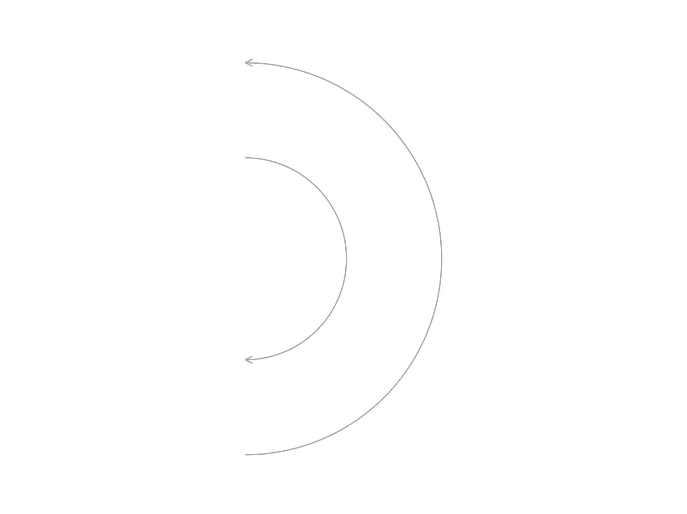

# Trim Curves

Trims a list of curves with a body.

_Cover: the block run on simple example inputs (spheres, boxes, curves) set up for the picture; that example notebook is not included._

## Install

1. Download `Trim Curves.ntop`.
2. In nTop, import it from the Custom Blocks panel (or open the file to see how the block is built).
   The block appears as **Trim Curves**.

Last saved in nTop 5.48.0; checked to open in nTop 6.4.3.

## Usage

Add the block to a notebook, wire the inputs below, and use its output downstream.

## Inputs

| Input | Type | Description |
|---|---|---|
| Curve | list of curve | Curves to trim. |
| Body | implicit body | Body used to trim the curves. |

## Output

| Output | Type |
|---|---|
| Trim Curves | list of curve |

## License

MIT License, copyright nTop; see `LICENSE`. Block descriptions were tidied with AI assistance (Claude).
