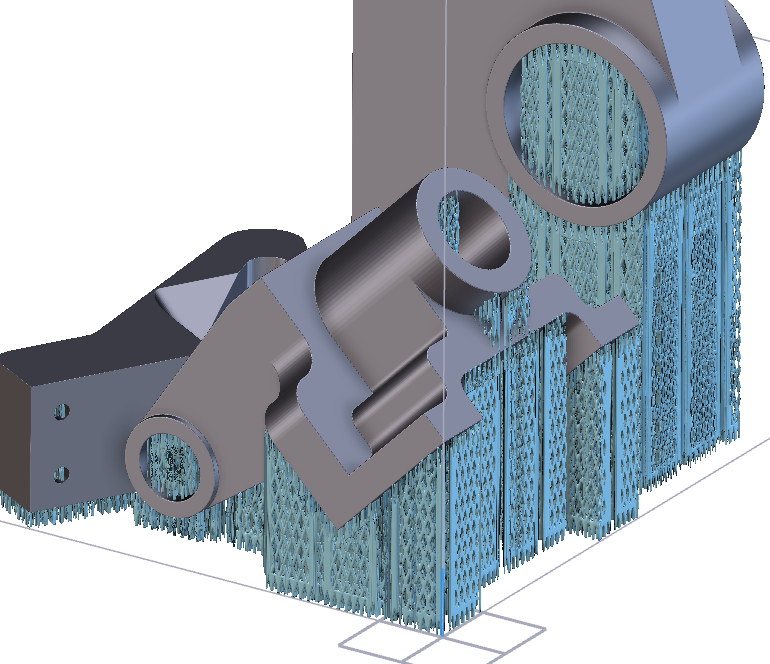

# Wall and Teeth Supports

A custom block that generates wall supports with teeth, contact ribs, diamond cut-outs and powder
drain gaps under any implicit body. You give it the part, the build plane and an overhang angle;
it finds the regions that need support by itself.

## What you need

- **nTop 6.4.3 or newer.** Built and saved in 6.4.3.
- `Wall and Teeth Supports.ntop` is the custom block on its own. It carries its nine helper
  blocks (Lattice Teeth Wall from Curve, Even Row Coordinate, Map Along Rows, Periodic Slab,
  Offset Along Build Direction, Tooth Field, Lattice field, Cube Bounding Box, Add Implicit Draft)
  inside it, so nothing else has to be registered. Add it to a notebook from the Custom Blocks
  panel (import), or open the file to read the block.

## How it works

1. **Shadow.** Manufacturing Support Volume finds every surface past the Overhang Angle and
   projects it down to the Build Plane, voxelized at Feature Size.
2. **Footprint loops.** The shadow is sectioned on the build plane (pulled in by XY Offset). Each
   closed loop of that section becomes one support region. Loops shorter than 16 × Feature Size
   are skipped.
3. **Walls per loop.** Inside each loop, nested walls are placed every Curve Offset, from the loop
   edge inwards, with Support Thickness and an optional Draft Angle. A signed loop field keeps the
   walls on the inside of the loop whatever its direction.
4. **Teeth.** Triangular teeth are cut where the walls meet the part and the build plate. The
   tooth coordinate is measured along each row, so every nested row gets the same pitch (Tooth
   Spacing) and a whole number of teeth. Thin contact ribs (Rectangle Thickness) sit on the tooth
   tips.
5. **Diamonds and gaps.** With Include Diamonds on, a diamond lattice (Unit Cell, DiamondHeight,
   DiamondWidth, Diamondspacing) is cut out of each wall between the tooth zones, and drain gaps
   one Tooth Spacing wide open every Gap Spacing.
6. **Clip.** All loops are united, clipped to the shadow offset by Z offset (so the supports reach
   into the part and the plate), and bounded by Bounds.

## Inputs

| Input | Type | What it does |
|---|---|---|
| Body | implicit | Part to support. Any implicit body: supports are made under every surface steeper than Overhang Angle. |
| Build Plane | plane | Build plate. Its normal is the build direction; supports run from the part down to this plane. |
| Overhang Angle | angle | Surfaces past this overhang angle get supports (same convention as Manufacturing Support Volume). |
| Feature Size | length | Voxel size of the support shadow. Smaller follows the part more closely but is slower. Footprint loops shorter than 16 × Feature Size are skipped. |
| Curve Offset | length field | Distance between the nested support walls inside each footprint loop. |
| Draft Angle | angle | Draft of the support walls, growing with distance from the part. 0 keeps the walls vertical. |
| Tolerance | length | Tolerance used when cutting the footprint loops out of the shadow. |
| Z offset | length | How far the supports reach into the part and into the build plate, along the build direction. |
| XY Offset | length | Pulls the support footprint in from the edge of the shadow by this distance. 0 uses the full shadow. |
| Support Thickness | length field | Thickness of each support wall. |
| Tooth Spacing | length | Pitch of the teeth along each wall, kept even on every nested row. Also the width of the drain gaps. |
| Tooth height | length | Height of the teeth where the walls meet the part and the build plate. |
| Unit Cell | unit cell | Lattice unit cell cut out of the walls as the diamond pattern. |
| DiamondHeight | length | Height of one diamond cell. |
| DiamondWidth | length | Width of one diamond cell, along the wall. |
| Diamondspacing | length | Spacing between neighbouring diamond cut-outs. |
| Diamond from bottom | length | Solid band kept above the bottom teeth before the diamonds start. |
| Diamond from top | length | Solid band kept below the top teeth before the diamonds start. |
| Include Diamonds | bool | On: walls with teeth, contact ribs, diamond cut-outs and drain gaps. Off: plain walls with teeth only. |
| Bounds | bounding box | Bounding box of the supports. Make it large enough to hold the part and reach the build plate. |
| Gap Spacing | length field | Distance between powder drain gaps along each wall. Keep it well above Tooth Spacing (the gap width), or the gaps remove every wall. |
| Rectangle Thickness | length | Width of the thin contact ribs at each tooth tip. |

Output: one implicit body holding all the supports.

## Tips and limits

- **Gap Spacing must be well above Tooth Spacing.** The drain gaps are one Tooth Spacing wide; a
  Gap Spacing close to it removes every wall and the output is empty.
- **Footprint loops are taken at the build plate.** A shadow that lands on the part rather than
  the plate is supported only where its outline also appears in the plate section.
- **Start coarse.** Feature Size sets the shadow voxel size; begin at about 0.5–1 mm and refine
  once the layout looks right. Every footprint loop is evaluated separately, so many small loops
  cost more than a few large ones.
- A sharp corner in a footprint loop can make one tooth on that row up to about one Tooth Spacing
  longer than the others.

## Files

| File | What it is |
|---|---|
| `Wall and Teeth Supports.ntop` | the custom block (v1.0.24), with a description on every input |
| `cover.png` | the block on a set of nested parts |
| `LICENSE` | MIT License |

## License

Released under the MIT License; see `LICENSE`.

Built with AI assistance (Claude).
