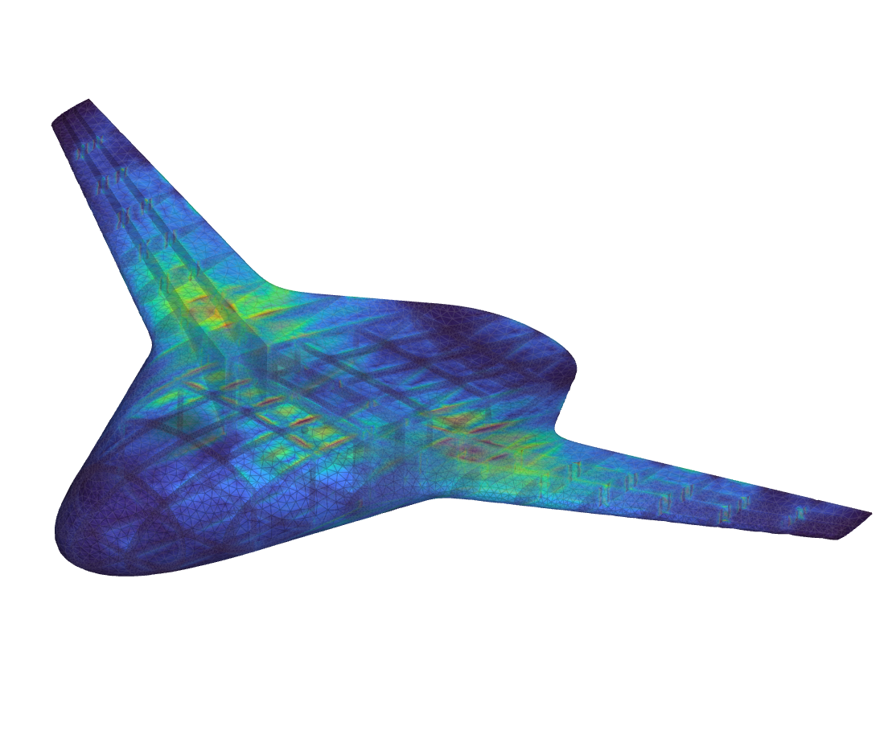

# BlendedNet V2 Structures with LBM Aero Loads

A parametric blended wing body (BWB) aircraft built in nTop, with internal structure and an aero-structural analysis chain. The notebook:

- builds the outer mold line from parametric planform and airfoil inputs;
- generates internal structure: wing ribs and spars, a center-body wingbox, and fuselage ribs and spars;
- runs an aircraft flow analysis (lattice Boltzmann method, LBM) to get the aerodynamic loads;
- maps the aero force field and an acceleration load onto a shell FE model (Al 7075-T6) and runs a static analysis;
- reports skin and structure mass, and exports von Mises stress and displacement point maps, mesh-node CSVs and an STL.

The notebook was built with help from Claude (AI-assisted).

## Installation and use

1. Download `blendednet-v2-structures-lbm.ntop`. It is self-contained; no extra input files are needed.
2. Open it in nTop 6.2 or newer. The flow analysis uses nTop's aircraft flow analysis toolkit, so your license must include it.
3. **Set the export folder.** The notebook's working/export folder is set to the author's machine (`C:/Users/matthewmueller/Documents/bwb_pp_ntop/`). Point the export folder input at a folder on your own machine before running, otherwise the export blocks will fail.
4. Edit the planform, airfoil and structure inputs (for example `# of Ribs`, `# of Fuselage Ribs`, `# of Fuselage Spars`), then rebuild to regenerate the geometry, flow loads and stress results.

The flow and structural analyses are computationally heavy; expect long rebuild times on large meshes.

## Inputs and outputs

| Direction | Name or control | Meaning |
|---|---|---|
| Input | Planform and airfoil parameters | BWB outer mold line shape |
| Input | `# of Ribs`, `# of Fuselage Ribs`, `# of Fuselage Spars` | Internal structure layout |
| Input | Flight condition (AOA and flow settings) | Drives the LBM aircraft flow analysis |
| Input | Export folder | Where CSV, STL and point-map files are written |
| Output | Aircraft Skin Mass and structure mass | Mass properties of the shell structure |
| Output | Von Mises stress and displacement point maps | Static analysis results under aero and inertial loads |
| Output | Rib, spar/wingbox, fuselage structure and skin mesh-node CSVs | Mesh node data for downstream use |

## Evidence and limits

- Published from the author's working notebook; this exact copy was not reopened in nTop after packaging.
- The structural model is a conceptual aluminum shell model for design exploration. It is not a qualified or certified structural analysis.

## License and credits

MIT. See [LICENSE](LICENSE).
